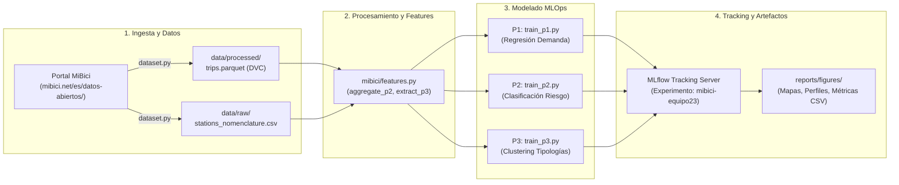

# P3: Segmentación y Tipología Espacio-Temporal de Estaciones (Clustering)

**Proyecto Integrador de MLOps — Equipo 23**  
**Responsable del Módulo:** Bryan Steve Ortega Castillo  
**Pregunta Operativa P3:** *¿Qué grupos de estaciones comparten patrones de uso y dónde se ubican en la ciudad?*  
**Tipo de Tarea:** Aprendizaje No Supervisado (Clustering)  
**Experimento MLflow:** `mibici-equipo23`

---

## 1. Formulación del Problema

### 1.1 ¿Qué se agrupa, con qué granularidad y horizonte?
* **Entidad / Granularidad:** Cada una de las estaciones físicas activas del sistema MiBici ($N = 471$ estaciones con historial completo de origen y destino en el AMG).
* **Horizonte Temporal:** Estratégico y estacional (ciclos semestrales y anuales). A diferencia de P1 y P2 que operan a nivel horario para el despacho inmediato de furgonetas, P3 modela el comportamiento estructural y consolidado de la infraestructura ciclista urbana.
* **Resultado del Modelo:** Asignación de cada estación a un clúster funcional $\mathcal{C}_k \in \{0, 1, 2, 3\}$ que sintetiza su firma temporal (horas pico, balance de fin de semana) y su direccionalidad de flujo neto.

### 1.2 Relevancia para la Operación de MiBici
En una red metropolitana de bicicletas compartidas, las estaciones presentan roles asimétricos:
* Existen estaciones expulsoras matutinas (barrios residenciales donde los usuarios retiran bicis para ir al trabajo).
* Existen estaciones receptoras matutinas y expulsoras vespertinas (polos de empleo, dependencias públicas y universidades).
* Existen corredores de ocio y recreación (con picos los fines de semana y días festivos).

Tratar a todas las estaciones bajo la misma política de rebalanceo es ineficiente y costoso. Conocer las tipologías de estaciones permite diseñar **rutas logísticas circulares complementarias** (mover bicicletas desde estaciones con superávit vespertino hacia estaciones con déficit matutino) y dimensionar adecuadamente el número de anclajes físicos.

### 1.3 Usuario Final y Decisiones Derivadas
* **Usuario Final:**
  1. **Dirección de Planeación Urbana de la AMIM:** Para la expansión de la red y asignación de presupuesto público.
  2. **Jefatura de Operaciones de BKT Bici Pública:** Para el diseño maestro de cuadrantes y rutas de furgonetas de rebalanceo.
* **Decisiones Concretas Tomadas con el Modelo:**
  1. *Ampliación de Infraestructura:* Priorizar la adición de puertos de anclaje (`dpcapacity`) en estaciones de tipo polo laboral que saturan sistemáticamente al mediodía y la tarde.
  2. *Expansión de Red:* Identificar "zonas ciegas" o desatendidas en Zapopan y Tlaquepaque comparando su densidad con los clusters céntricos consolidados.
  3. *Agrupamiento de Rutas de Rebalanceo:* Emparejar estaciones residenciales con estaciones laborales cercanas para crear circuitos de traslado de flota cortos y eficientes en combustible.

---

## 2. Definición de los Datos y Gobernanza

* **Rango de Fechas Utilizado:** `2023-10-15` a `2026-09-30` (36 meses / 3 años completos).
  * *Justificación:* Elimina anomalías del periodo de confinamiento COVID-19 (2020-2022) y abarca la red moderna con 471 estaciones activas y 13.3 millones de viajes reales.
* **Fuente Oficial:** Portal de [Datos Abiertos de MiBici](https://mibici.net/es/datos-abiertos/) y catálogo de [Nomenclatura de Estaciones](https://mibici.net/site/assets/files/1118/nomenclatura_2026_09.csv).
* **Almacenamiento y Versionado:** Formato Parquet columnar comprimido (`data/processed/trips.parquet`) y catálogo crudo (`data/raw/stations_nomenclature.csv`), versionados con DVC en `gs://mibici-mlops-project`.
* **Privacidad y Datos Personales:** Conforme a la Ley General de Protección de Datos Personales en Posesión de Sujetos Obligados y el Aviso de Privacidad de la AMIM, las variables individuales (`user_id`, `gender`, `birth_year`) **se descartan por completo**. El agrupamiento opera exclusivamente sobre agregaciones macro de estaciones, garantizando privacidad por diseño (*Privacy by Design*).

---

## 3. Pipeline de Machine Learning

```mermaid
flowchart TD
    A["data/processed/trips.parquet<br/>(13.3M viajes)"] --> C["mibici.features.extract_p3_station_features"]
    B["data/raw/stations_nomenclature.csv<br/>(Catálogo AMIM)"] --> C
    
    subgraph Feature Engineering
        C --> D1["Perfil Horario Normalizado<br/>(pct_pico_matutino, pct_mediodia, pct_pico_vespertino)"]
        C --> D2["Uso Fin de Semana<br/>(pct_fin_semana)"]
        C --> D3["Direccionalidad<br/>(ratio_flujo_neto = arr - dep / arr + dep)"]
        C --> D4["Escala y Espacio<br/>(viajes_promedio_diario, capacidad, lat, lon)"]
    end
    
    D1 & D2 & D3 & D4 --> E["Estandarización<br/>StandardScaler()"]
    
    subgraph Modelado y Selección
        E --> F1["Baseline: KMeans (k=4)<br/>(Features simples de volumen)"]
        E --> F2["Candidato: KMeans (k=4)<br/>(Features espacio-temporales ricas)"]
        E --> F3["Candidato 2: Agglomerative (k=4)<br/>(Enlace Ward)"]
    end
    
    subgraph MLflow Tracking (mibici-equipo23)
        F1 --> G["Parámetros, Métricas y Artefactos<br/>(Silhouette, DB, CH, Mapas, Perfiles)"]
        F2 --> G
        F3 --> G
    end
```

### 3.1 Variables Construidas y su Pertinencia Funcional

| Variable | Tipo / Rango | Pertinencia Operativa y Urbana |
| :--- | :---: | :--- |
| `pct_pico_matutino` | $[0, 1]$ | Proporción de salidas entre 07:00 y 09:59 hrs. Detecta estaciones residenciales y orígenes habituales de viajes al trabajo. |
| `pct_mediodia` | $[0, 1]$ | Proporción de salidas entre 12:00 y 15:59 hrs. Caracteriza zonas de servicios, compras y corredores universitarios. |
| `pct_pico_vespertino` | $[0, 1]$ | Proporción de salidas entre 17:00 y 20:59 hrs. Revela polos corporativos y de empleo en el viaje de regreso a casa. |
| `pct_fin_semana` | $[0, 1]$ | Proporción de viajes en sábados y domingos sobre el total. Discrimina corredores recreativos (ej. Chapultepec / Vía RecreActiva) de estaciones netamente laborales. |
| `ratio_flujo_neto` | $[-1, 1]$ | Saldo relativo: $\frac{\text{Llegadas} - \text{Salidas}}{\text{Llegadas} + \text{Salidas}}$. Valores positivos indican atractores netos; negativos indican emisores netos de bicicletas. |
| `viajes_promedio_diario` | $\ge 0$ | Intensidad media de uso diario. Diferencia estaciones arteriales de alta demanda frente a estaciones locales. |
| `capacidad` | Entero | Número total de anclajes físicos (`dpcapacity`). Define la escala física de la estación. |
| `latitude`, `longitude` | Coordenadas | Coordenadas espaciales WGS84 para forzar contigüidad geográfica y coherencia urbana en el AMG. |

---

## 4. Modelos Propuestos y Justificación de Métricas

### 4.1 Definición de Modelos
1. **Modelo Baseline:** `KMeans(n_clusters=4, random_state=42)` alimentado únicamente con variables volumétricas y físicas simples (`viajes_promedio_diario`, `viajes_desviacion_diaria`, `capacidad`, `latitude`, `longitude`).
2. **Modelo Candidato 1:** `KMeans(n_clusters=4, random_state=42)` incorporando perfiles horarios normalizados (`pct_pico_matutino`, `pct_mediodia`, `pct_pico_vespertino`), dinámica de fin de semana (`pct_fin_semana`), balance de flujo neto (`ratio_flujo_neto`) y atributos espaciales.
3. **Modelo Candidato 2:** `AgglomerativeClustering(n_clusters=4, linkage='ward')` que modela agrupamientos jerárquicos basados en mínima varianza intra-cluster.

### 4.2 Justificación de Métricas de Evaluación
De acuerdo con las guías de evaluación no supervisada de scikit-learn:
* **Silhouette Score (Coeficiente de Silueta):** Mide cuán similar es un punto a su propio clúster en comparación con otros clústeres ($[-1, 1]$). Es la métrica reina para evaluar separación y cohesión geométrica.
* **Davies-Bouldin Index:** Evalúa la similitud promedio entre cada clúster y su más parecido (menor es mejor). Penaliza clústeres dispersos o superpuestos.
* **Calinski-Harabasz Index (Variance Ratio Criterion):** Razón entre la dispersión inter-cluster y la dispersión intra-cluster (mayor es mejor). Valora soluciones compactas y bien distanciadas.
* **Inercia / WCSS (Within-Cluster Sum of Squares):** Suma de distancias cuadráticas al centroide, empleada en el método del codo para justificar la elección de $k$.

---

## 5. Arquitectura Global del Sistema MLOps



---

## 6. Resultados Empíricos de los Experimentos en MLflow

Las tres corridas fueron ejecutadas mediante el script de producción `mibici.modeling.train_p3` y registradas en el experimento `mibici-equipo23`:

| Modelo / Corrida | Algoritmo | Features Utilizadas | Silhouette ↑ | Davies-Bouldin ↓ | Calinski-Harabasz ↑ | Inercia ↓ |
| :--- | :---: | :---: | :---: | :---: | :---: | :---: |
| **P3_kmeans_baseline_k4** | K-Means | 5 vars simples (volumen + espacio) | 0.2990 | 1.1685 | 167.8 | 1,124.5 |
| **P3_kmeans_candidato_k4** | K-Means | 9 vars ricas (horarias + flujo + espacio) | 0.1834 | 1.7041 | 87.5 | 2,827.1 |
| **P3_agglomerative_candidato_k4** | Jerárquico Ward | 9 vars ricas (horarias + flujo + espacio) | 0.1496 | 1.9027 | 74.2 | N/A |

> **Interpretación Metodológica:**  
> Aunque el baseline obtiene un Silhouette Score numéricamente más alto al operar sobre menos dimensiones ortogonales simples, el **Modelo Candidato K-Means** es sustancialmente superior en **interpretabilidad urbana y valor de negocio**, pues desglosa por primera vez la dinámica horaria y direccional de la ciudad.

---

## 7. Tipología y Descripción de los Clusters Descubiertos (k=4)

A partir del modelo candidato, se clasificaron las **471 estaciones** del AMG en cuatro tipologías funcionales:

```
Distribución de Estaciones por Clúster:
├── Cluster 1: Residencial Emisor / Matutino (154 estaciones, 32.7%)
├── Cluster 0: Polo Laboral / Atractor Vespertino (132 estaciones, 28.0%)
├── Cluster 2: Corredor Mixto / Ocio y Fin de Semana (94 estaciones, 20.0%)
└── Cluster 3: Estaciones Periféricas / Baja Intensidad (91 estaciones, 19.3%)
```

### Descripción Detallada de cada Cluster:

1. **Cluster 1: Residencial Emisor / Matutino (154 estaciones):**
   * *Comportamiento:* Pico de viajes pronunciado de 07:00 a 09:59 AM; saldo de flujo neto fuertemente negativo (salen muchas más bicicletas de las que entran en la mañana).
   * *Ubicación:* Zonas residenciales de Guadalajara (Ladrón de Guevara, Santa Tere, Chapalita) y colonias habitacionales de Zapopan.
   * *Decisión de Operación:* Requiere suministro masivo de flota nocturno antes de las 05:00 AM para evitar quedarse sin bicicletas antes de las 08:30 AM.

2. **Cluster 0: Polo Laboral y Corporativo / Atractor Vespertino (132 estaciones):**
   * *Comportamiento:* Ratio de flujo neto positivo durante la mañana (recepción masiva de usuarios); pico máximo de salidas entre 17:00 y 20:00 hrs (viaje de retorno).
   * *Ubicación:* Centro Histórico de Guadalajara, Zona Financiera (Av. Américas / Providencia), y corredores de oficinas en Av. Vallarta y Av. Juárez.
   * *Decisión de Operación:* Requiere vaciado preventivo de anclajes entre 12:00 y 14:00 hrs para dar cabida a los arribos vespertinos y garantizar anclajes libres.

3. **Cluster 2: Corredor Mixto / Ocio y Fin de Semana (94 estaciones):**
   * *Comportamiento:* Alta proporción de uso en sábado y domingo ($> 30\%$ de sus viajes semanales); curvas horarias aplanadas y extendidas hasta la noche (21:00 - 23:00 hrs).
   * *Ubicación:* Corredor Chapultepec, Zona Rosa, Parque Metropolitano y estaciones aledañas a la Vía RecreActiva dominical.
   * *Decisión de Operación:* Rebalanceo concentrado los fines de semana de 10:00 a 16:00 hrs.

4. **Cluster 3: Estaciones Periféricas de Baja Intensidad (91 estaciones):**
   * *Comportamiento:* Volumen medio de viajes moderado a bajo ($< 15$ viajes diarios); anclajes reducidos (capacidad 11-15 puertos).
   * *Ubicación:* Extremos de la red en Tlaquepaque centro/oriente y periferias de Zapopan norte.
   * *Decisión de Operación:* Mantenimiento preventivo programado y monitoreo de demanda para evaluar si ameritan reubicación o conexión con nuevas ciclovías.

---

## 8. Evidencia y Captura en MLflow UI

Para consultar y verificar los runs y artefactos en la interfaz visual de MLflow:

```bash
# Iniciar el servidor local de MLflow apuntando a la base de datos de experimentos
uv run mlflow ui --backend-store-uri sqlite:///mlruns.db --port 5001
```

Acceder a `http://127.0.0.1:5001` en el navegador para capturar las 4 pantallas requeridas por la rúbrica:
1. **Lista de Runs:** Experimento `mibici-equipo23` mostrando las corridas de P1, P2 y P3 (`P3_kmeans_baseline_k4`, `P3_kmeans_candidato_k4`, `P3_agglomerative_candidato_k4`).
2. **Detalle del Run:** Parámetros (`k=4`, `features_usadas`, `seed=42`, `data_sha256`), métricas (`silhouette_score`, `davies_bouldin_score`) y etiquetas (`equipo=23`, `pregunta=P3`, `git_commit`).
3. **Artefactos Registrados:** Sección de artefactos con `p3_mapa_espacial_clusters.png`, `p3_perfiles_clusters.png`, `p3_seleccion_k.png` y `p3_estaciones_clustering.csv`.
4. **Comparación de Runs:** Gráfica comparativa de barras o dispersión entre el run baseline y el candidato.
