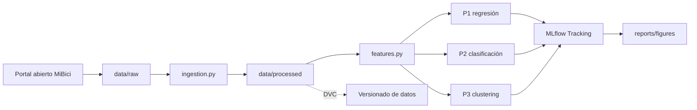

# Arquitectura propuesta

La ejecución local usa Python, pandas y scikit-learn. MLflow conserva
parámetros, métricas, tags y artefactos; Git conserva código y documentación;
DVC debe conservar las versiones de los CSV sin incluirlos directamente en
GitHub.

