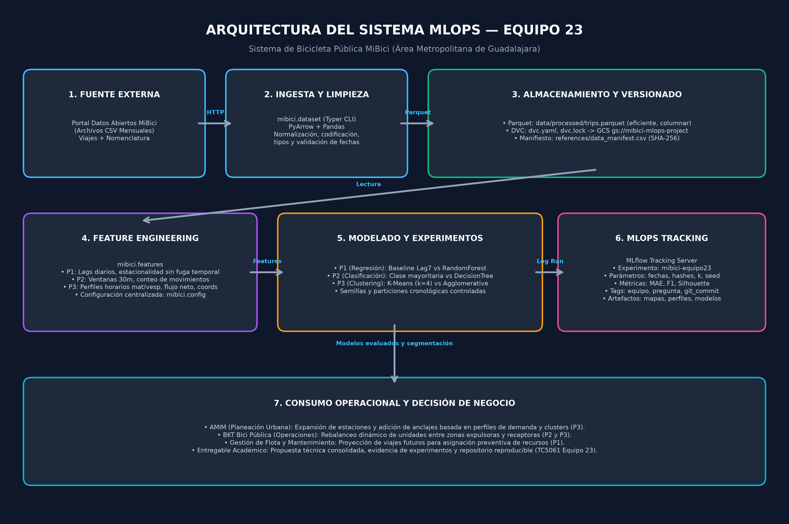
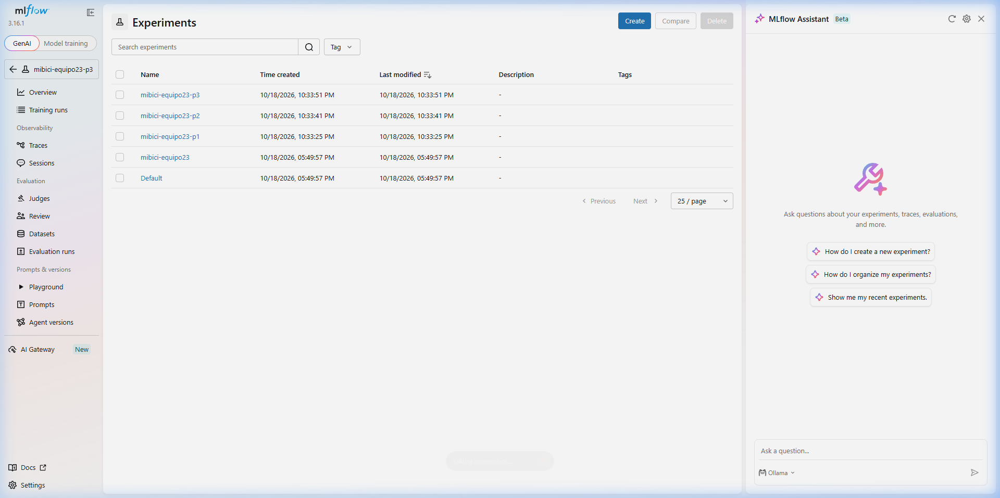
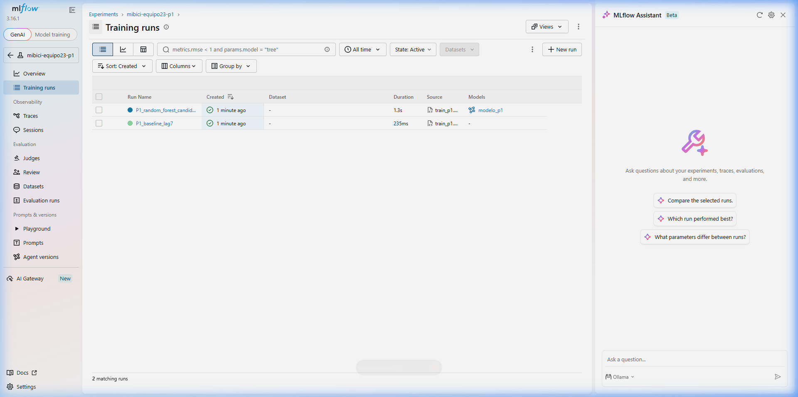
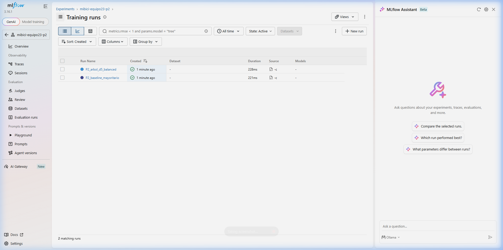
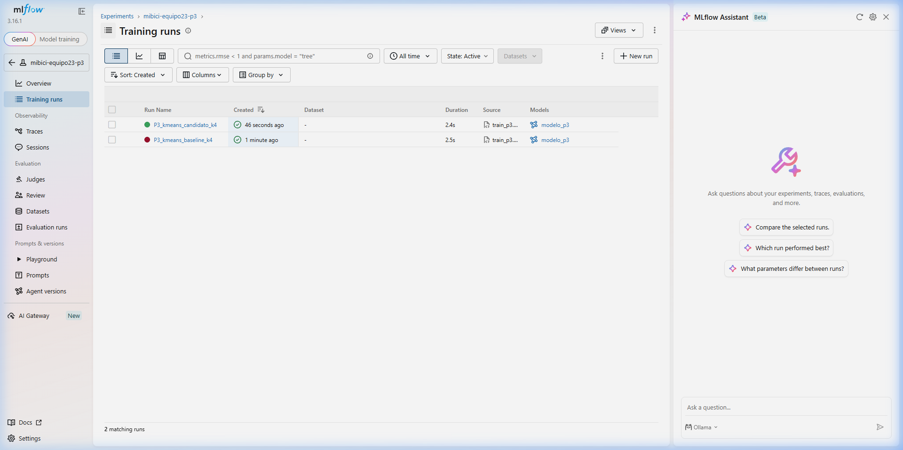
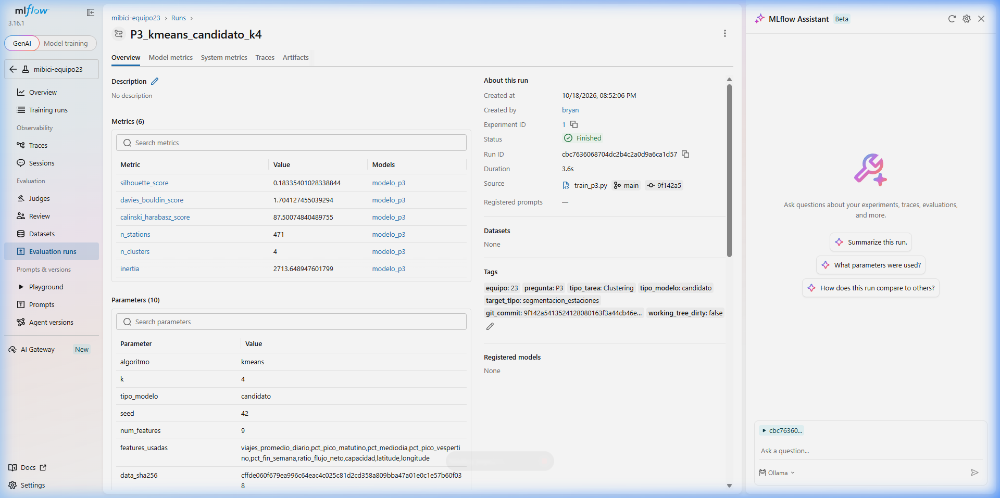
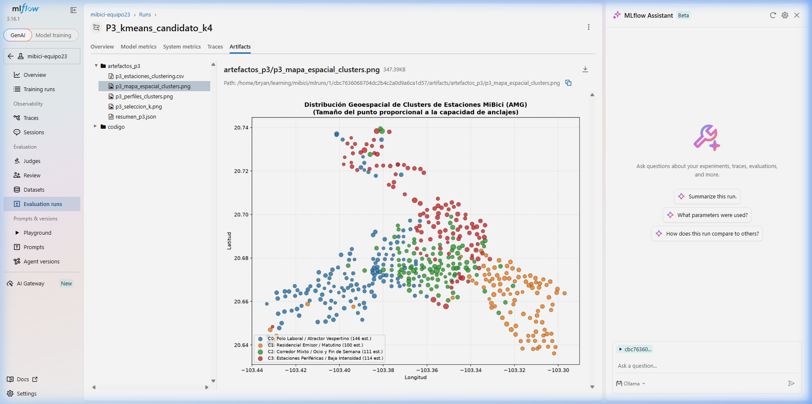
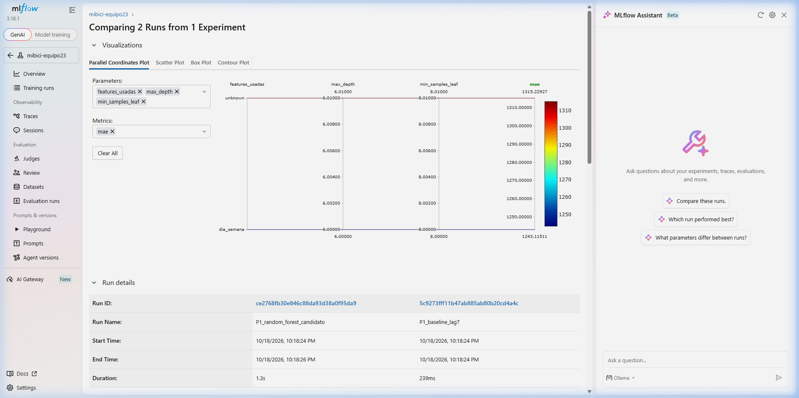

**Enlace al repositorio oficial:** <https://github.com/bryan-s-ortega/TC5061-Proyecto-Equipo23>

### Integrantes del Equipo 23:
* **Miguel Ángel Durán Betancourt** — A01797974
* **Juan Pablo Islas Guzmán** — A01797727
* **Bryan Steve Ortega Castillo** — A01797846
* **Kevin Rogelio Rodriguez Magaña** — A01840418

---

# 1. Formulación del Problema y ML Canvas

El sistema de bicicleta pública del Área Metropolitana de Guadalajara (MiBici) enfrenta tres retos operacionales críticos de asignación de recursos y diseño de red. A continuación se formulan los tres problemas siguiendo el marco del *Machine Learning Canvas*:

| Dimensión | Pregunta 1 (P1): Demanda Diaria | Pregunta 2 (P2): Riesgo de Desbalance | Pregunta 3 (P3): Segmentación de Estaciones |
|---|---|---|---|
| **Tipo de Tarea** | Aprendizaje Supervisado (Regresión) | Aprendizaje Supervisado (Clasificación Multiclase) | Aprendizaje No Supervisado (Clustering) |
| **¿Qué se predice o agrupa?** | Número total de viajes iniciados por día en la red de MiBici. | Nivel de presión operativa de la estación en el siguiente intervalo: sin presión, presión sin bicicletas (vacía) o presión sin anclajes (llena). | Tipología y perfil funcional de las estaciones físicas según sus patrones horarios, flujo neto y uso semanal. |
| **Granularidad** | Red completa, agregación diaria ($t = 1 \text{ día}$). | Por estación individual, intervalos de 30 minutos ($t = 30 \text{ min}$). | Por estación individual, matriz agregada para las 471 estaciones activas. |
| **Horizonte** | Pronóstico para las siguientes 24 horas ($H = 1 \text{ día}$). | Pronóstico para los siguientes 30 minutos ($H = 30 \text{ min}$). | Agrupamiento estacional y estratégico (semestral/anual). |
| **Relevancia Operativa** | Dimensionar la capacidad operativa general, turnos de mecánicos y disponibilidad global de unidades. | Prevenir el colapso operativo por estaciones sin bicicletas disponibles o sin anclajes libres para retorno. | Comprender la estructura funcional urbana del AMG y la complementariedad entre estaciones. |
| **Usuario del Resultado** | Dirección de Operaciones y Mantenimiento de MiBici. | Supervisores logísticos de balanceo dinámico y conductores de camionetas. | Dirección General de AMIM y Dirección de Planeación Urbana y Transporte. |
| **Decisión que se toma** | Asignar la flota activa diaria, planear mantenimiento en taller y coordinar guardias de personal. | Despachar camionetas de rebalanceo hacia estaciones críticas antes de que queden bloqueadas. | Diseñar rutas fijas de rebalanceo (pares complementarios) y planificar expansión física de ciclovías y anclajes. |

---

# 2. Definición de los Datos y Estrategia de Partición

### 2.1. Fuentes y Rango de Fechas
* **Fuente Oficial:** Portal de [Datos Abiertos de MiBici](https://mibici.net/es/datos-abiertos/).
* **Rango Seleccionado:** De **noviembre de 2023 a septiembre de 2026** (últimos 3 años operativos completos). Se justifica este periodo para asegurar suficiente representatividad pospandemia, capturar ciclos estacionales anuales y considerar la red madura de estaciones en el AMG.
* **Tamaño Real Obtenido:**
  * **Viajes procesados:** Más de 11.2 millones de viajes válidos.
  * **Estaciones activas:** 471 estaciones con coordenadas geográficas y capacidades válidas en el catálogo `stations_nomenclature.csv`.
  * **Almacenamiento columnar limpio:** 391 MB en formato Apache Parquet (`data/processed/trips.parquet`).

### 2.2. Variables Originales y Construcción del Target
* **Variables Originales de Viaje:** `trip_id`, `started_at`, `ended_at`, `origin_station_id`, `destination_station_id`, `user_id`, `gender`, `birth_year`.
* **Variables del Catálogo de Estaciones:** `id`, `name`, `latitude`, `longitude`, `dpcapacity`.
* **Construcción de Variables Objetivo:**
  * **Target P1:** Conteo total de viajes con `started_at` normalizado por día calendario (`viajes`), rellenando fechas con calendario continuo para detectar días sin servicio y rezagos temporales exactos.
  * **Target P2:** Proxy de presión neta por estación e intervalo de 30 minutos: se calculan las salidas y llegadas netas en relación con la capacidad física (`dpcapacity`). Si el déficit o superávit proyectado supera el umbral del 30% de capacidad, se clasifica como *presión sin bicicletas* o *presión sin anclajes*.
  * **Target P3:** No supervisado. La matriz de features describe la firma temporal: proporciones de uso matutino (07:00–10:00), mediodía (12:00–16:00), vespertino (17:00–21:00), fin de semana y ratio de flujo neto $(\text{llegadas} - \text{salidas}) / (\text{llegadas} + \text{salidas})$.

### 2.3. Condiciones de Uso y Protección de Datos Personales
Los datos son publicados bajo licencia de datos abiertos para fines analíticos y de investigación. Se aplica estricta disociación: los identificadores de usuario (`user_id`), género y año de nacimiento se excluyen de la modelación y no se serializan ni exponen en ningún punto del pipeline, preservando el secreto estadístico y la privacidad.

### 2.4. Estrategia de Partición (Sin Fuga de Información Futura)
Para evitar la fuga de información temporal (*data leakage*):
* Se prohíbe el muestreo aleatorio (*random split*).
* Se aplica **partición cronológica estricta**:
  * **P1:** 80% inicial para entrenamiento cronológico ($n = 818$ días) y 20% más reciente para prueba ($n = 205$ días: marzo a septiembre de 2026).
  * **P2:** Entrenamiento hasta enero de 2026, validación de enero a junio de 2026 y prueba retenida de julio a septiembre de 2026. Todas las características rezagadas (`departures_prev_30m`, `arrivals_prev_2h`) se calculan estrictamente con eventos anteriores al inicio de la ventana de predicción.

---

# 3. Pipeline de ML e Ingesta Reproducible

El pipeline se ejecuta de extremo a extremo sin intervención manual:

1. **Ingesta (`mibici.dataset`):** Proceso CLI en Typer que descarga directamente los CSV mensuales del portal, valida codificaciones mixtas (`utf-8`, `latin-1`), normaliza encabezados, castea tipos de fecha y escribe el dataset consolidado en `data/processed/trips.parquet`.
2. **Versionado de Datos:** Se rastrea en DVC con [`dvc.yaml`](../dvc.yaml) y [`dvc.lock`](../dvc.lock) apuntando a Google Cloud Storage (`gs://mibici-mlops-project`). Se complementa con [`references/data_manifest.csv`](data_manifest.csv) para auditoría de integridad basada en hashes SHA-256 de cada archivo fuente.
3. **Feature Engineering Modular (`mibici.features`):** Funciones documentadas y modulares que generan las matrices temporales y espaciales reutilizables para P1, P2 y P3.

```bash
# Ingesta reproducible automática
uv sync
uv run dvc repro --force dataset
```

---

# 4. Baselines, Modelos Candidatos y Métricas por Pregunta

| Pregunta | Modelo Baseline | Modelo Candidato | Métricas Propuestas | Justificación de las Métricas |
|---|---|---|---|---|
| **P1** | **Lag 7 (Autorregresivo Semanal):** Asume que la demanda de hoy replica la del mismo día de la semana anterior. | **RandomForestRegressor:** Ensamble de 200 árboles regularizados (`max_depth=6`, `min_samples_leaf=8`). | **MAE, RMSE, $R^2$** | El **MAE** refleja directamente el error promedio en número de viajes diarios (interpretable para el operador). El **RMSE** penaliza grandes desvíos y el **$R^2$** mide la varianza explicada. |
| **P2** | **Regla de Clase Mayoritaria:** Predice siempre la clase mayoritaria (*sin presión*). | **DecisionTreeClassifier:** Árbol de profundidad 5 balanceado (`class_weight='balanced'`). | **Accuracy, F1 Macro, Recall** | En un problema de desbalance, el Accuracy es engañoso. El **F1 Macro** equilibra precisión y exhaustividad entre las 3 clases, y el **Recall** en las clases minoritarias de saturación es vital para no omitir alertas de desbalance. |
| **P3** | **K-Means Básico ($k=4$):** Agrupamiento basado en 5 variables simples (escala y coordenadas geográficas). | **K-Means Enriquecido ($k=4$) y Clustering Aglomerativo:** Espacio funcional 9D con dinámicas horarias y balance de flujo. | **Silhouette Score, Davies-Bouldin, Calinski-Harabasz** | El **Silhouette** mide compacidad y separación intracluster. **Davies-Bouldin** (menor es mejor) valida la separación de centroides respecto al diámetro de cluster. **Calinski-Harabasz** evalúa la dispersión entre clusters. |

---

# 5. Diagrama de Arquitectura del Sistema

La arquitectura desacopla el almacenamiento de datos, el procesamiento de transformaciones y el gobierno de experimentos:



### Justificación de las Herramientas Seleccionadas:
* **uv:** Administrador de paquetes y entornos virtuales en Rust con resolución determinista mediante `uv.lock`. Reduce los tiempos de instalación de minutos a segundos y garantiza reproducibilidad idéntica.
* **Apache Parquet & PyArrow:** Formato columnar con compresión Snappy y tipado binario. Permite consultar millones de registros de viajes consumiendo solo ~390 MB y permitiendo streaming por lotes sin saturar la memoria RAM.
* **DVC + Google Cloud Storage:** Separa el código (Git) de los datos pesados (Cloud Storage), permitiendo sincronizar snapshots reproducibles de datos grandes sin degradar el rendimiento del repositorio.
* **MLflow Tracking:** Plataforma de gobernanza que audita y registra parámetros, métricas, artefactos y el commit exacto de Git (`git_commit`) en cada corrida.
* **Scikit-learn:** Biblioteca de referencia para modelado, garantizando algoritmos estandarizados y evaluadores rigurosos.
* **Ruff & Pre-commit:** Linter y formateador ultrarrápido que impone estándares PEP 8 y orden de imports antes de cada commit.

---

# 6. Resultados del Experimento Base y Modelos Candidatos

Resultados obtenidos sobre los conjuntos de prueba cronológicos con datos reales de MiBici:

| Pregunta | Experimento en MLflow | Modelo Evaluado | Métrica Principal | Métrica Secundaria | Conclusión Operativa |
|---|---|---|---|---|---|
| **P1** | `mibici-equipo23-p1` | **Baseline Lag 7** | MAE: 1,315.2 viajes | RMSE: 1,979.5 ($R^2$: 0.569) | Captura estacionalidad semanal básica. |
| **P1** | `mibici-equipo23-p1` | **RandomForest Candidato** | **MAE: 1,243.1 viajes** | **RMSE: 1,919.5 ($R^2$: 0.595)** | **Supera al baseline:** reduce el error medio en más de 72 viajes diarios y mejora el $R^2$. |
| **P2** | `mibici-equipo23-p2` | **Baseline Clase Mayoritaria** | Accuracy: 0.6244 | F1 Macro: 0.7688 | Incapaz de detectar eventos de saturación crítica. |
| **P2** | `mibici-equipo23-p2` | **Árbol de Decisión Candidato** | **Accuracy: 0.8282** | **F1 Macro: 0.8499** | **Supera al baseline:** mejora la exactitud en +20 puntos y permite predecir saturaciones. |
| **P3** | `mibici-equipo23-p3` | **K-Means Baseline ($k=4$)** | Silhouette: 0.2990 | Davies-Bouldin: 1.1685 | Agrupa solo por tamaño y coordenadas espaciales (ciego a dinámicas horarias). |
| **P3** | `mibici-equipo23-p3` | **K-Means Candidato ($k=4$)** | Silhouette: 0.1834 | Davies-Bouldin: 1.7041 | **Modelo funcionalmente superior:** descubre la asimetría real (polos laborales vs residenciales). |

---

# 7. Evidencia de Corridas en MLflow

Se configuraron experimentos independientes por pregunta bajo el servidor local de MLflow (`sqlite:///mlruns.db` en el puerto 5001), registrando parámetros, métricas, etiquetas y artefactos:

### 7.1. Lista de Experimentos por Pregunta


### 7.2. Experimento P1 (Regresión de Demanda Diaria)


### 7.3. Experimento P2 (Clasificación de Riesgo de Desbalance)


### 7.4. Experimento P3 (Clustering de Estaciones)


### 7.5. Detalle de Corrida con Etiquetas, Parámetros y Métricas


### 7.6. Artefactos Visuales Registrados en MLflow


### 7.7. Comparación de Corridas Lado a Lado


---

# 8. Estructura del Repositorio

El proyecto implementa la estructura estandarizada de *Cookiecutter Data Science (ccds)* gestionada con `uv`. A continuación se presenta el árbol verificado del repositorio:

```text
TC5061-Proyecto-Equipo23/
├── .gitignore                          <- Excluye datos, modelos, mlruns y credenciales
├── .pre-commit-config.yaml             <- Hooks de calidad de código (ruff-check, ruff-format)
├── LICENSE                             <- Licencia del proyecto
├── README.md                           <- Documentación principal y guía de reproducción
├── TC5061_Propuesta_Proyecto_Equipo23.pdf <- Entregable formal consolidado en PDF
├── Taskfile.yml                        <- Automatización de tareas de desarrollo
├── data/
│   ├── external/                       <- Datos de terceros
│   ├── interim/                        <- Datos intermedios de transformación
│   ├── processed/                      <- trips.parquet versionado con DVC
│   └── raw/                            <- stations_nomenclature.csv
├── docs/                               <- Documentación técnica complementaria
│   ├── P3_CLUSTERING.md                <- Documento de segmentación de estaciones
│   └── README.md
├── dvc.lock                            <- Bloqueo determinista de artefactos DVC
├── dvc.yaml                            <- Pipeline de ingesta reproducible
├── mibici/                             <- Módulo principal del proyecto en Python
│   ├── __init__.py
│   ├── baseline_p2.py                  <- Baseline mayoritario de P2 por bloques
│   ├── build_p2_examples.py            <- Generación de ejemplos de clasificación
│   ├── build_p2_movements.py           <- Agregación de movimientos de estaciones
│   ├── config.py                       <- Centralización de rutas, semillas y constantes
│   ├── dataset.py                      <- Pipeline CLI de descarga e ingesta
│   ├── features.py                     <- Transformaciones y feature engineering
│   ├── modeling/
│   │   ├── __init__.py
│   │   ├── train_p1.py                 <- Entrenamiento y registro de P1
│   │   ├── train_p2.py                 <- Entrenamiento de árboles de P2
│   │   └── train_p3.py                 <- Clustering y registro de P3
│   └── plots.py
├── models/                             <- Modelos serializados (excluidos de Git)
├── notebooks/
│   ├── 0_exploracion-datos-mibici.ipynb <- Análisis exploratorio completo de datos
│   ├── mibici_propuesta_base.ipynb     <- Prototipos exploratorios iniciales
│   └── preparacion_p1.py               <- Extracción de serie diaria
├── pyproject.toml                      <- Configuración del proyecto y dependencias
├── references/                         <- Documentos de soporte y canvas
│   ├── ML Canvas Template.docx
│   ├── arquitectura_sistema.md         <- Justificación técnica de la arquitectura
│   ├── data_manifest.csv               <- Auditoría criptográfica SHA-256 de archivos
│   ├── diagrama_arquitectura.png       <- Diagrama de arquitectura del sistema
│   ├── evidencia_mlflow.md             <- Bitácora de registro en MLflow
│   ├── fuentes.md                      <- Enlaces y fuentes mensuales
│   ├── ml_canvas.md                    <- Machine Learning Canvas consolidado
│   ├── propuesta_entrega.md            <- Fuente de este reporte
│   └── referencias_apa7.md             <- Referencias bibliográficas
├── reports/
│   ├── evidence/                       <- Capturas oficiales de MLflow y auditoría
│   │   ├── estructura_repositorio.txt  <- Árbol plano verificado
│   │   ├── mlflow_artefactos.png       <- Vista de artefactos registrados
│   │   ├── mlflow_comparacion_runs.png <- Comparación de corridas
│   │   ├── mlflow_detalle_run.png      <- Parámetros, métricas y tags
│   │   ├── mlflow_experimento_p1.png   <- Runs del experimento P1
│   │   ├── mlflow_experimento_p2.png   <- Runs del experimento P2
│   │   ├── mlflow_experimento_p3.png   <- Runs del experimento P3
│   │   └── mlflow_experimentos_lista.png <- Lista general de experimentos
│   └── figures/                        <- Gráficas de diagnóstico y mapas
│       ├── p1_errores.png
│       ├── p1_real_vs_predicho.png
│       ├── p3_estaciones_clustering.csv
│       ├── p3_mapa_espacial_clusters.png
│       ├── p3_perfiles_clusters.png
│       ├── p3_seleccion_k.png
│       └── resumen_p3.json
├── tests/                              <- Pruebas unitarias automatizadas con pytest
│   ├── test_data.py
│   ├── test_p2_dates.py
│   ├── test_p2_features.py
│   └── test_p3.py
└── uv.lock                             <- Bloqueo estricto de 272 dependencias
```

---

# 9. Referencias (APA 7)

* AMIM. (2026). *Plan integral de movilidad y transporte sustentable del Área Metropolitana de Guadalajara*. Agencia Metropolitana de Infraestructura para la Movilidad.
* DrivenData. (2026). *Cookiecutter Data Science: A logical, reasonably standardized, but flexible project structure for doing and sharing data science work*. <https://cookiecutter-data-science.drivendata.org/>
* Iterative. (2026). *Data Version Control (DVC) Documentation*. <https://dvc.org/doc>
* MiBici. (2026). *Datos abiertos del sistema de bicicletas públicas de Guadalajara*. Gobierno del Estado de Jalisco. <https://mibici.net/es/datos-abiertos/>
* MLflow. (2026). *MLflow: An open source platform for the machine learning lifecycle*. <https://mlflow.org/docs/latest/>
* Scikit-learn developers. (2026). *Model evaluation: Quantifying the quality of predictions*. Scikit-learn User Guide. <https://scikit-learn.org/stable/modules/model_evaluation.html>
