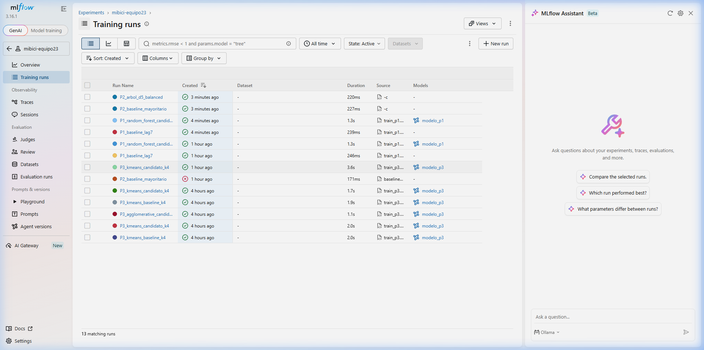
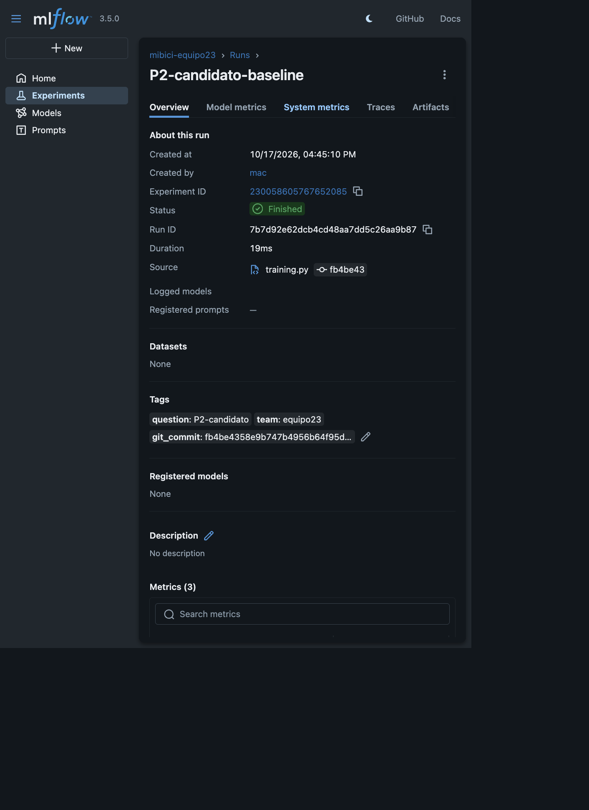
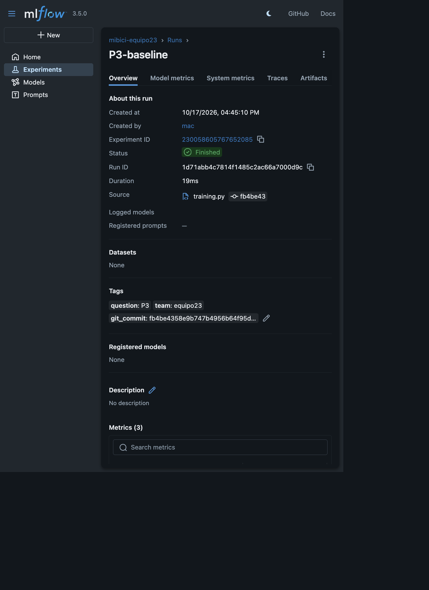
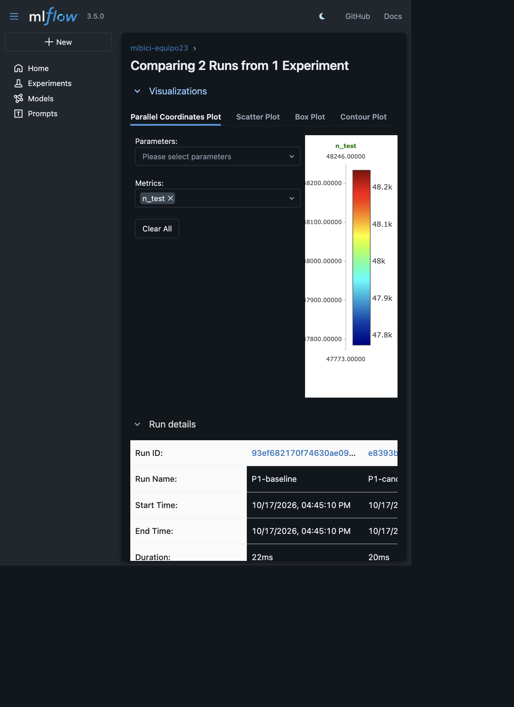

Repositorio del equipo: <https://github.com/bryan-s-ortega/MiBici>

# Integrantes

- Miguel Ángel Durán Betancourt
- Juan Pablo Islas Guzmán — A01797727
- Bryan Steve Ortega Castillo
- Kevin Rogelio Rodriguez Magaña

# 1. Problema y propuesta

El proyecto propone una solución reproducible de Machine Learning para las
tres preguntas operativas de MiBici:

| Pregunta | Tarea | Usuario | Decisión |
|---|---|---|---|
| P1. ¿Cuántos viajes se iniciarán? | Regresión | Operador | Asignar flota y personal |
| P2. ¿Habrá riesgo de saturación? | Clasificación | Rebalanceo | Priorizar inspección o traslado |
| P3. ¿Qué estaciones comparten patrones? | Clustering | Planeación urbana | Detectar perfiles y zonas |

La unidad de análisis es estación-día para P1 y P2, y estación-periodo para
P3. P1 predice los viajes del día siguiente. P2 construye una etiqueta proxy
de riesgo futuro a partir de demanda/capacidad, porque los datos abiertos no
contienen inventario histórico real. P3 agrupa estaciones por uso, capacidad y
ubicación.

# 2. Datos, uso y versionado

La fuente es el portal oficial de [Datos abiertos de
MiBici](https://www.mibici.net/en/open-data/). Se descargaron 21 archivos de
viajes, de enero de 2025 a septiembre de 2026, y el catálogo
`nomenclatura_2026_09.csv`. La consolidación contiene 7,894,097 viajes y 484
estaciones.

El proyecto usa las variables de viaje necesarias para fechas, horas, origen,
destino y duración, además de capacidad, latitud y longitud del catálogo. Los
identificadores de usuario no se usan como variables ni se publican.

Los CSV grandes no se suben a Git. El mecanismo principal de versionado es
DVC, con `dvc.yaml`, `dvc.lock` y un remoto configurado en el repositorio. La
ingesta también conserva un manifiesto complementario con archivo, filas,
bytes y SHA-256. Esto permite reconstruir el snapshot y verificar su
integridad.

# 3. Ingesta y feature engineering

La ingesta está disponible en `mibici/dataset.py`. Descarga los meses
seleccionados y la nomenclatura desde el portal oficial, normaliza columnas,
codificaciones y fechas, une el catálogo de estaciones y guarda el resultado
limpio en Parquet. La etapa está declarada en `dvc.yaml`.

```bash
uv sync
uv run dvc repro --force dataset
```

`mibici/features.py` genera las variables reutilizables para las preguntas.
Las particiones supervisadas son cronológicas y los features históricos se
construyen únicamente con información disponible antes del horizonte para
evitar fuga de información.

# 4. Modelos y métricas

| Pregunta | Baseline | Candidato | Métricas |
|---|---|---|---|
| P1 | Lag de demanda | RandomForestRegressor | MAE, RMSE, R² |
| P2 | Clase mayoritaria / presión | DecisionTreeClassifier | Accuracy, precision, recall, F1 |
| P3 | — | K-Means, k=4 | Silhouette |

Resultados con datos reales:

| Run | Resultado |
|---|---:|
| P1 baseline MAE | 11.6304 |
| P1 candidato MAE | 6.5447 |
| P1 candidato RMSE | 12.4127 |
| P2 baseline accuracy / F1 | 0.6244 / 0.7688 |
| P2 candidato accuracy / F1 | 0.8282 / 0.8499 |
| P3 silhouette | 0.4982 |

# 5. Arquitectura

Portal MiBici → `mibici/dataset.py` → DVC → `data/processed/trips.parquet` →
`mibici/features.py` → P1/P2/P3 → MLflow Tracking → `reports/figures/`.
Git conserva código y documentación; DVC identifica el snapshot de datos y el
manifiesto SHA-256 aporta una verificación adicional.

# 6. MLflow y reproducibilidad

El experimento es `mibici-equipo23`. Incluye los runs P1-baseline,
P1-candidato-baseline, P2-baseline, P2-candidato-baseline y P3-baseline.
Cada run registra parámetros, métricas, etiquetas de equipo/pregunta/commit y
artefactos.










# 7. Repositorio y entrega

El repositorio conserva la estructura Cookiecutter Data Science:
`data/`, `notebooks/`, `mibici/`, `models/`, `reports/` y `references/`.
El README documenta GitHub Flow, DVC, dependencias y reproducción. Los CSV,
`mlruns/`, modelos serializados y credenciales están excluidos mediante
`.gitignore`.

La entrega final debe incluir este PDF, el enlace al repositorio accesible para
el profesor y la evidencia de colaboración de GitHub: rama principal
protegida, commits de los cuatro integrantes, Pull Requests y revisiones.

# Referencias

Consultar [`referencias_apa7.md`](referencias_apa7.md) y
[`fuentes.md`](fuentes.md) para las referencias completas y las fuentes
mensuales.
