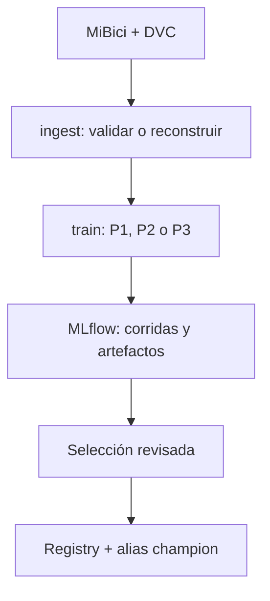

# Propuesta de integración del Equipo 23 — MLflow Projects y Model Registry

## Decisión común

Implementamos tres entradas de MLflow Projects (`ingest`, `train`, `search`)
con un parámetro `question=P1|P2|P3` y modelos explícitos. Todas las nuevas
corridas se consultan en el experimento `mibici-equipo23-mlprojects`. Los
experimentos anteriores de P1, P2 y P3 siguen existiendo con sus nombres
históricos; no se cambiaron sus resultados. Cada integrante puede revisar la
interfaz y proponer cambios mediante PR antes de integrar.

`python_env.yaml` declara dependencias fijadas y `uv.lock` resuelve el entorno
del equipo. `dvc.yaml` incluye tres etapas P2 nuevas, con fechas fijas y
archivos corregidos. La materialización de `dvc.lock`/cache y su carga a GCS
requieren ejecución desde un entorno con los datos y permisos.

## Estado comprobado de P2

- Observación: estación × 30 minutos; variables: salidas y llegadas de los
  últimos 30 minutos y dos horas, hora, minuto, día y capacidad. Nunca usan
  movimientos del intervalo objetivo como predictores.
- Etiqueta: saldo neto de viajes futuros dividido por capacidad. Es un
  indicador de presión, no un registro de inventario. No permite afirmar que
  una estación quedó realmente sin bicicletas o sin anclajes.
- Particiones fijas previas: train hasta fin de 2025, validación primer
  semestre 2026, prueba segundo semestre 2026 dentro de la cobertura.
  La prueba se abre una sola vez después de seleccionar la mejor corrida.
- Corridas reales **anteriores**: árbol balanceado profundidad 5 obtuvo
  `val_balanced_accuracy=0.63799`, recall `sin_bicicletas=0.72638` y
  `sin_anclajes=0.44248`; precision respectivas `0.00874` y `0.03093`.
  El árbol sin ponderación obtuvo accuracy `0.99446` pero recall cero
  en la clase `sin_bicicletas`. Estos números no son resultados de las
  nuevas corridas de MLflow Projects.
- La búsqueda nueva compara tres árboles y baseline dentro de un padre;
  conserva la misma muestra de train para los cuatro, elige balanced accuracy
  sujeta a recall mínimo por clase y registra test solo en la ganadora.
  Artefactos: matrices de confusión exactas, curvas PR aproximadas, JSON de
  parámetros, métricas y hash SHA-256 del dataset. Modelo con firma y ejemplo
  de entrada. Las pruebas de integración con **datos sintéticos** pasaron;
  falta ejecutar con el dataset real y capturar las métricas.

## Responsabilidades para cerrar la actividad

| Trabajo | Responsable propuesto | Evidencia necesaria |
|---|---|---|
| Revisar interfaz y PR | Equipo completo | Una revisión por integrante |
| Ejecutar P2 con datos reales y versionar DVC | Miguel | DVC lock/cache, runs anidados, test y captura |
| Ejecutar tres variantes P1 y registrar ganador | Responsable P1 | Métricas comparables y captura Registry |
| Ejecutar tres variantes KMeans P3 y registrar ganador | Responsable P3 | Silhouette/DB/CH y captura Registry |
| Consolidar PDF | Quien coordina la entrega | Capturas, enlaces, interpretación y límites |

P1 y P3 también tienen búsquedas de tres candidatos con corridas anidadas.
P1 selecciona por MAE de validación y evalúa test una vez. P3 elige por
silhouette y requiere interpretación sustantiva de cada agrupamiento.
P3 es clustering descriptivo: sus métricas internas no equivalen a accuracy
ni hay partición supervisada train/validation/test. Para registrar un modelo
de P3 capaz de predecir la asignación de una estación nueva, usar KMeans.

El alias `champion` del registro identifica la versión académica preferida.
Antes de desplegar P2 harían falta sensores de inventario o fotografías de
ocupación, evaluación por estación y un criterio operativo de alertas que
contemple los falsos positivos actuales. No hay despliegue a producción.

## Evidencias por incorporar al PDF del equipo

1. Captura del experimento nuevo con corridas hijas de P2 y métricas de
   validación/test tras correr `search` sobre datos reales.
2. Captura de los tres modelos registrados y alias `champion`, con versiones
   y corridas fuente; evidencia de cargar y predecir con cada uno.
3. Tabla comparativa real de P1/P2/P3 y límites de cada pregunta.
4. Enlace al PR, revisiones del equipo, hash de commit, `dvc.lock` actualizado
   y evidencia del push al remoto DVC.

Comandos concretos y requisitos previos: ver sección **MLflow Projects** del
README. Ninguna cifra de la prueba sintética debe mezclarse con las métricas
de la entrega real.
