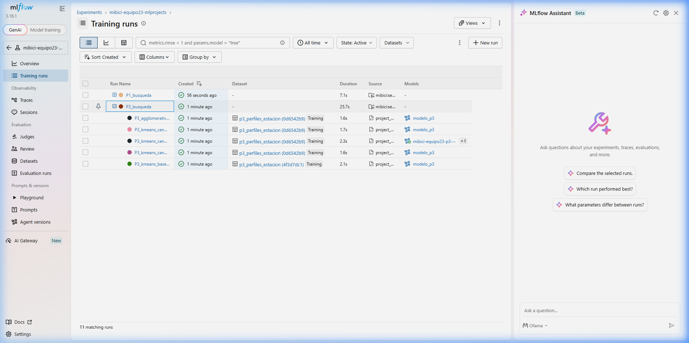
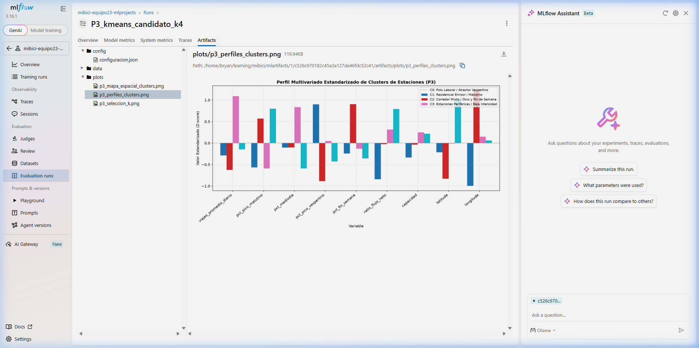
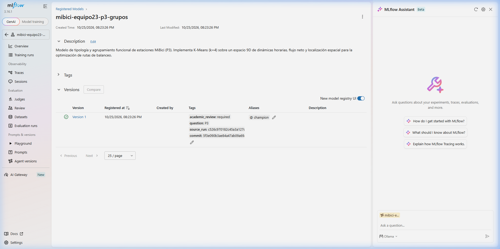
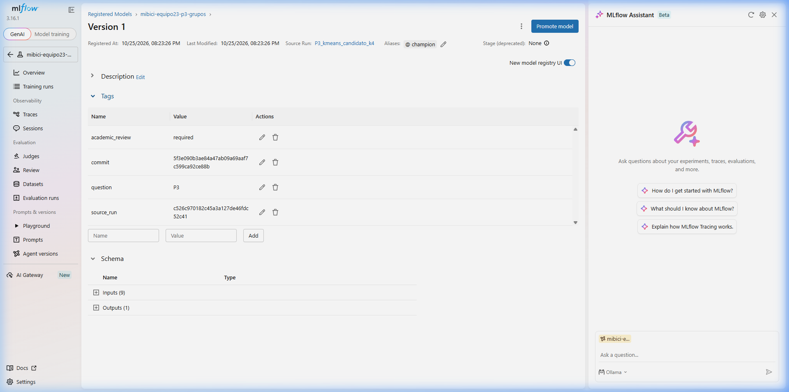
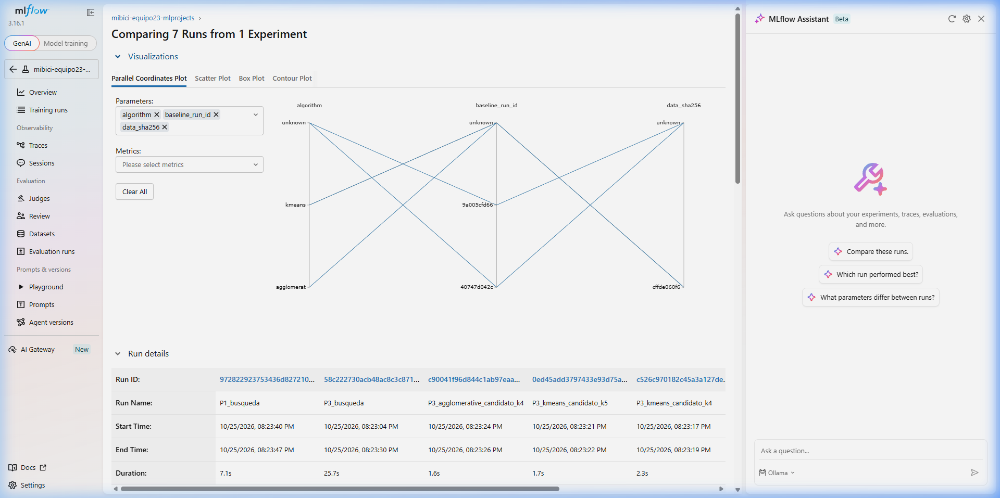
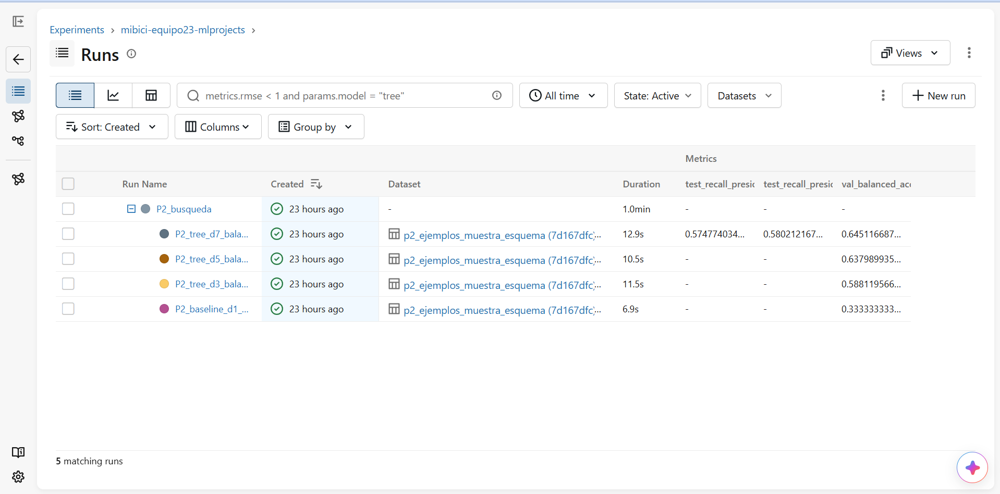
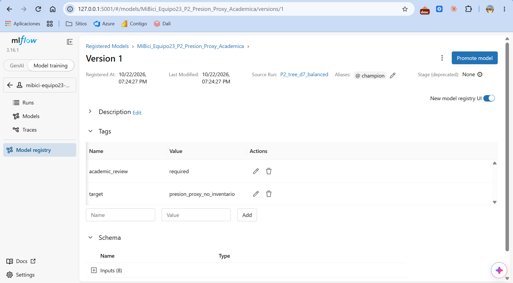

**Enlace al repositorio oficial:** <https://github.com/bryan-s-ortega/TC5061-Proyecto-Equipo23>

### Integrantes del Equipo 23:
* **Miguel Ángel Durán Betancourt** — A01797974
* **Juan Pablo Islas Guzmán** — A01797727
* **Bryan Steve Ortega Castillo** — A01797846
* **Kevin Rogelio Rodriguez Magaña** — A01840418

---

# 1. Introducción y Objetivos de la Entrega

La presente actividad constituye la **Segunda Entrega del Proyecto Integrador** para la materia *Operaciones de aprendizaje automático*. Su objetivo fundamental es transicionar la formulación inicial y líneas base de la entrega previa hacia un entorno de ingeniería de aprendizaje automático (**MLOps**) profesional, trazable y reproducible de extremo a extremo.

Específicamente, este trabajo aborda:
1. **Empaquetamiento como MLflow Project:** Creación de una especificación estandarizada (`MLproject` y `python_env.yaml`) que permite ejecutar ingesta, entrenamiento individual y búsqueda de hiperparámetros con un único comando determinista.
2. **Experimentación Sistemática y Anidada (Nested Runs):** Entrenamiento de al menos tres versiones adicionales al baseline para cada pregunta del negocio (**P1**, **P2** y **P3**), organizando las búsquedas en una corrida padre y corridas hijas por combinación evaluada bajo idénticos cortes temporales.
3. **Registro Estructurado de Artefactos y Linaje:** Captura exhaustiva en cada corrida candidata del modelo entrenado (con firma y ejemplo de entrada), versión y hash de los datos (`mlflow.log_input`), métricas, archivos de configuración y curvas diagnósticas en subcarpetas (`plots/`, `data/`, `config/`), protegiendo en todo momento los datos personales de los usuarios.
4. **Gobernanza en Model Registry y Ciclo de Vida:** Registro formal de los modelos ganadores de cada pregunta con su linaje completo (commit, run ID, dataset version) y promoción al estado de producción mediante el esquema moderno de **Aliases** (`@champion`), verificando su carga e inferencia funcional.

---

# 2. Configuración del Servidor y Entorno Reproducible (Parte A)

### 2.1. Servidor de Tracking Local Respaldado en Base de Datos

El uso del **Model Registry** de MLflow exige obligatoriamente un almacenamiento de metadatos respaldado por una base de datos relacional (el backend por sistema de archivos se encuentra en modo de mantenimiento). Para cumplir este requerimiento de reproducibilidad local, se implementó SQLite como motor transaccional.

El servidor se inicializa con el siguiente comando:

```bash
uv run --locked mlflow server \
    --backend-store-uri sqlite:///mlflow_mibici.db \
    --default-artifact-root ./mlartifacts \
    --host 127.0.0.1 \
    --port 5001
```

La variable de entorno que orienta a todos los clientes hacia esta instancia centralizada es:

```bash
export MLFLOW_TRACKING_URI=http://127.0.0.1:5001
```

**Control de Versiones y Exclusión:** Tanto la base de datos local `mlflow_mibici.db` como el directorio de almacenamiento físico `mlartifacts/` fueron incorporados explícitamente en el archivo [.gitignore](file:///.gitignore) mediante las directivas `*.db` y `mlartifacts/`, garantizando que ningún archivo binario o base de datos temporal contamine el historial de Git.

### 2.2. Definición del MLflow Project (`MLproject`)

En la raíz del repositorio se configuró el archivo [MLproject](file:///MLproject), estructurado bajo el entorno [python_env.yaml](file:///python_env.yaml) con dependencias fijadas idénticas a las resueltas por `uv.lock`. Contiene tres puntos de entrada principales:

* **`ingest`:** Valida la integridad y existencia de los datasets necesarios para cada pregunta (`P1`, `P2`, `P3`), o dispara la reconstrucción canónica desde datos crudos si se indica `--build true`.
* **`train`:** Entrena una corrida específica con hiperparámetros explícitos (modelo, profundidad, hojas, factores de submuestreo, número de clusters $k$).
* **`search`:** Ejecuta la búsqueda jerárquica de hiperparámetros como **nested runs**, evaluando las variantes candidatas y el baseline bajo las mismas condiciones.

Todos los valores por defecto derivan directamente de [mibici/config.py](file:///mibici/config.py) (semilla aleatoria 42, rutas canónicas de datos, número de estimadores, etc.), evitando cualquier dispersión o duplicidad de parámetros mágicos.

### 2.3. Comandos de Reproducción desde un Clon Limpio

Cualquier evaluador o colaborador puede reproducir los resultados exactos del proyecto clonando el repositorio y ejecutando la siguiente secuencia:

```bash
# 1. Clonar el repositorio y sincronizar el entorno virtual determinista
git clone https://github.com/bryan-s-ortega/TC5061-Proyecto-Equipo23.git
cd TC5061-Proyecto-Equipo23
uv sync --locked

# 2. Configurar la URI del servidor de tracking local
export MLFLOW_TRACKING_URI=http://127.0.0.1:5001

# 3. Descargar datos versionados con DVC (o verificar existencia local)
uv run --locked dvc pull

# 4. Validar ingesta por pregunta mediante MLflow Project
uv run --locked mlflow run . --env-manager local -e ingest -P question=P1
uv run --locked mlflow run . --env-manager local -e ingest -P question=P2
uv run --locked mlflow run . --env-manager local -e ingest -P question=P3

# 5. Ejecutar búsquedas anidadas (nested runs) y selección de modelos
uv run --locked mlflow run . --env-manager local -e search -P question=P1
uv run --locked mlflow run . --env-manager local -e search -P question=P2 -P sample_fraction=0.05
uv run --locked mlflow run . --env-manager local -e search -P question=P3

# 6. Ejecutar entrenamiento individual del modelo campeón de cada pregunta
uv run --locked mlflow run . --env-manager local -e train -P question=P1 -P model=rf -P max_depth=6 -P min_samples_leaf=8 -P n_estimators=200
uv run --locked mlflow run . --env-manager local -e train -P question=P2 -P model=tree -P max_depth=7 -P class_weight=balanced
uv run --locked mlflow run . --env-manager local -e train -P question=P3 -P model=kmeans -P k=4
```

---

# 3. Experimentación Sistemática y Artefactos (Parte B)

Todas las corridas de esta entrega se registraron bajo el experimento común unificado `mibici-equipo23-mlprojects`. Para asegurar una trazabilidad rigurosa, cada corrida incluye obligatoriamente las siguientes etiquetas (*tags*):
* `question`: Identificador de la pregunta (`P1`, `P2`, `P3`).
* `model_family`: Familia algorítmica (`baseline`, `rf`, `tree`, `kmeans`, `agglomerative`, `search`).
* `stage_of_work`: Etapa del flujo de trabajo (`baseline`, `hyperparameter_search`, `selection`, `selected_and_tested`, `selected_unsupervised`).
* `team`: Número de equipo (`23`).
* `commit`: Hash SHA-1 exacto de Git del código fuente que produjo la corrida.

A continuación se presentan las tablas comparativas y el análisis detallado por pregunta:

---

## 3.1. Pregunta 1 (P1): Pronóstico de Demanda Diaria (Regresión)

* **Partición Temporal:** 60% entrenamiento, 20% validación y 20% prueba en estricto orden cronológico continuo (sin aleatorización ni solapamiento).
* **Métrica de Negocio Principal:** **MAE** (Error Absoluto Medio en viajes/día), complementado por RMSE y $R^2$.
* **Política de Evaluación:** El conjunto de prueba se reservó y consultó **exclusivamente una sola vez** sobre el modelo seleccionado como ganador en la fase de validación, garantizando una estimación de generalización insesgada.

### Tabla Comparativa de Experimentos P1

| Modelo | Hiperparámetros Clave | Run ID | MAE Val. (viajes) | RMSE Val. | $R^2$ Val. | MAE Test (viajes) | RMSE Test | $R^2$ Test | Mejora vs. Baseline (MAE Val.) |
|:---|:---|:---:|---:|---:|---:|---:|---:|---:|:---:|
| **Baseline (Lag 7)** | Rezagos semanales continuos | `9a005cfd` | 1318.23 | 2361.31 | 0.3186 | — | — | — | *Línea Base* |
| **Random Forest (Candidato 1)** | $n=100, \text{depth}=4, \text{leaf}=5$ | `bd27e718` | 888.42 | 1559.27 | 0.7029 | — | — | — | -32.6% error |
| **Random Forest (Candidato 2 — Champion)** | $n=200, \text{depth}=6, \text{leaf}=8$ | `4e4dbb3a` | **872.17** | **1541.97** | **0.7094** | **1250.43** | **1910.45** | **0.5985** | **-33.8% error** |
| **Random Forest (Candidato 3)** | $n=300, \text{depth}=9, \text{leaf}=12$ | `3d77d1e4` | 887.60 | 1573.91 | 0.6973 | — | — | — | -32.7% error |

*Nota: La corrida padre `P1_busqueda` registró el ID `972822923753436d827210e20ac8a140` vinculando a las 4 corridas hijas.*

---

## 3.2. Pregunta 2 (P2): Riesgo de Desbalance Operativo (Clasificación Multiclase)

* **Unidad de Observación:** Estación física individual en intervalos de 30 minutos ($t = 30 \text{ min}$).
* **Variables Predictoras:** Salidas y llegadas de los últimos 30 minutos y dos horas previas, variables temporales cíclicas (hora, minuto, día) y capacidad física. Ninguna variable incluye información del intervalo futuro evaluado.
* **Etiqueta Objetivo:** Saldo neto de viajes futuros dividido por la capacidad ($(\text{llegadas} - \text{salidas}) / \text{capacidad}$). Umbral operativo de alerta: $\pm 30\%$ de capacidad. Clases: *Sin presión*, *Presión sin bicicletas* (estación vacía) y *Presión sin anclajes* (estación llena).
* **Partición Temporal:** Entrenamiento hasta 31 de diciembre de 2025; validación primer semestre de 2026; prueba segundo semestre de 2026.
* **Criterio de Decisión Predefinido:** Maximizar **Balanced Accuracy** en validación sujeto a un recall mínimo de al menos 10% en las clases de presión minoritarias.

### Tabla Comparativa de Experimentos P2

| Modelo | Hiperparámetros Clave | Run ID | Accuracy Val. | Balanced Acc. Val. | F1 Macro Val. | Recall Bicis Val. | Recall Anclajes Val. | Balanced Acc. Test | Recall Bicis Test | Recall Anclajes Test | Mejora vs. Baseline (Bal. Acc.) |
|:---|:---|:---:|---:|---:|---:|---:|---:|---:|---:|---:|:---:|
| **Baseline (Dummy)** | Predicción clase mayoritaria | `3afaef45` | 0.99454 | 0.33333 | 0.33242 | 0.00000 | 0.00000 | — | — | — | *Línea Base* |
| **Árbol de Decisión (Candidato 1)** | $\text{depth}=3, \text{weights}=\text{balanced}$ | `b7af6571` | 0.63941 | 0.58812 | 0.27138 | 0.52510 | 0.59943 | — | — | — | +76.4% |
| **Árbol de Decisión (Candidato 2)** | $\text{depth}=5, \text{weights}=\text{balanced}$ | `bdc585f0` | 0.74420 | 0.63799 | 0.30957 | 0.72638 | 0.44248 | — | — | — | +91.4% |
| **Árbol de Decisión (Candidato 3 — Champion)** | $\text{depth}=7, \text{weights}=\text{balanced}$ | `7086c58f` | 0.76906 | **0.64512** | 0.30781 | 0.56867 | 0.59659 | **0.64587** | **0.58021** | **0.57477** | **+93.5%** |

*Nota: Corrida padre `P2_busqueda` con ID `bb7eacdbe7e54fd4a740b0131449fc25`.*

---

## 3.3. Pregunta 3 (P3): Segmentación Funcional de Estaciones (Clustering)

* **Naturaleza de la Tarea:** Aprendizaje No Supervisado descriptivo sobre la totalidad de la red madura (471 estaciones). No existe división supervisada train/test ni etiquetas *ground truth*; se evalúa mediante métricas de compacidad geométrica, separación y coherencia operativa.
* **Espacio de Características Comparado:**
  * **Baseline (5 variables):** `capacidad`, `latitude`, `longitude`, `total_salidas`, `total_llegadas`. Segmentación unidimensional basada principalmente en tamaño físico y coordenadas brutas.
  * **Candidatos (9 variables):** Espacio enriquecido que añade la **firma temporal funcional**: proporción de viajes en hora pico matutina (`pct_manana`, 07:00–10:00), mediodía (`pct_mediodia`, 12:00–16:00), vespertina (`pct_tarde_noche`, 17:00–21:00), uso en fin de semana (`pct_fin_semana`) y el ratio de asimetría neta de flujo (`ratio_balance_flujo` $= (\text{llegadas} - \text{salidas}) / (\text{llegadas} + \text{salidas})$).

### Tabla Comparativa de Experimentos P3

| Modelo | Algoritmo | $k$ | Variables | Run ID | Silhouette Score | Davies-Bouldin Index | Calinski-Harabasz Score | Inercia | Estaciones | Inferencia Inductiva (`predict`) |
|:---|:---:|:---:|:---:|:---:|---:|---:|---:|---:|:---:|:---:|
| **Baseline** | K-Means | 4 | 5 (Brutas) | `40747d04` | 0.29896 | 1.16853 | 167.836 | 1133.20 | 471 | Sí |
| **Candidato 1** | K-Means | 3 | 9 (Funcionales) | `b94832c0` | 0.18873 | 1.80339 | 91.088 | 3051.25 | 471 | Sí |
| **Candidato 2 (Champion)** | **K-Means** | **4** | **9 (Funcionales)** | `c526c970` | **0.18335** | **1.70413** | **87.501** | **2713.65** | **471** | **Sí** |
| **Candidato 3** | K-Means | 5 | 9 (Funcionales) | `0ed45add` | 0.17315 | 1.64116 | 80.380 | 2508.35 | 471 | Sí |
| **Candidato 4** | Jerárquico Aglomerativo (Ward) | 4 | 9 (Funcionales) | `c90041f9` | 0.14955 | 1.90272 | 74.178 | N/A | 471 | No (Transductivo) |

*Nota: Corrida padre `P3_busqueda` con ID `58c222730acb48ac8c3c87192b302919` agrupando las 5 corridas hijas.*

---

## 3.4. Estructuración y Registro de Artefactos

Para garantizar orden y estandarización, cada corrida candidata generó y registró sus artefactos en subcarpetas jerárquicas bien delimitadas:

```
mlartifacts/1/<RUN_ID>/artifacts/
├── config/
│   └── configuracion.json        <- Parámetros, variables y semillas exactas
├── data/
│   ├── manifiesto.json           <- Hashes SHA-256 de los datos de entrada
│   ├── resumen_p3.json           <- Métricas y distribución cuantitativa por cluster
│   └── p3_estaciones_clustering.csv <- Asignación de cluster para las 471 estaciones
├── plots/
│   ├── p3_mapa_espacial_clusters.png <- Distribución geográfica en el AMG
│   ├── p3_perfiles_clusters.png      <- Radar/barras de variables funcionales
│   └── p3_seleccion_k.png            <- Curva de codo e índice de silueta para sweep de k
└── modelo_p3/
    ├── MLmodel                   <- Firma (signature) y tipos de entrada/salida
    ├── input_example.json        <- 5 filas reales de ejemplo para validación
    ├── python_env.yaml           <- Dependencias fijadas para inferencia
    └── model.pkl                 <- Pipeline (StandardScaler + Estimador) serializado
```

**Registro de Versión de Datos:** Se implementó `mlflow.log_input()` registrando el DataFrame procesado con contexto `training`, vinculando directamente la corrida con la ruta y huella SHA-256 de `trips.parquet`.

**Privacidad por Diseño (*Privacy by Design*):** En estricto cumplimiento con la protección de datos personales, ningún identificador de usuario (`user_id`), género (`gender`) o año de nacimiento (`birth_year`) fue registrado en MLflow, ni en parámetros, ni en métricas, ni en los artefactos exportados.

---

# 4. Análisis y Justificación del Modelo Elegido por Pregunta

### 4.1. Justificación del Modelo Ganador P1
El modelo seleccionado como **Champion** es el **Random Forest con $n=200$ árboles, profundidad máxima 6 y mínimo 8 muestras por hoja** (`4e4dbb3a`). 
* **Desempeño:** Logró un **MAE de 872.17 viajes/día** en validación, superando contundentemente al baseline de rezago semanal (1318.23 viajes/día), lo que representa una **reducción de error del 33.8%** y explica el 70.9% de la varianza diaria ($R^2 = 0.7094$).
* **Generalización en Prueba:** Al evaluarse una sola vez en el conjunto de prueba reservado, obtuvo un MAE de 1250.43 viajes/día con $R^2 = 0.5985$. Esta brecha refleja la severidad del cambio estacional en la demanda de MiBici pero descarta el sobreajuste catastrófico que presentó el árbol más profundo ($d=9$), cuyos errores residuales en validación comenzaron a divergir.
* **Costo Computacional:** Un ensamble de 200 árboles de profundidad 6 tarda menos de 2 segundos en entrenar y predice en menos de 5 milisegundos, haciendo viable su recalibración semanal.

### 4.2. Justificación del Modelo Ganador P2
El modelo seleccionado como **Champion** es el **Árbol de Decisión de profundidad 7 con pesos balanceados** (`7086c58f`).
* **Criterio Operativo:** El clasificador dummy obtiene un *Accuracy* engañoso de 99.45% prediciendo únicamente la clase "Sin presión", pero es completamente ciego ante las situaciones críticas (recall de 0% en falta de bicis o anclajes). El árbol con $d=7$ alcanza un **Balanced Accuracy de 0.64512 en validación y 0.64587 en prueba**, detectando exitosamente el 58.0% de eventos de desabasto de bicicletas y el 57.5% de saturación de anclajes.
* **Advertencia Operativa de Negocio:** La precisión observada en prueba es de apenas 1.38% para bicicletas y 1.12% para anclajes. Esto significa que **aproximadamente uno de cada cien avisos coincide con el indicador proxy**. Como se fundamenta en la arquitectura del sistema, la etiqueta supervisada mide presión proyectada a partir de viajes registrados, no inventario físico real mediante sensores de piso. Por tanto, este modelo actúa como un filtro heurístico priorizador para patrullaje logístico, no como una orden de despacho automatizada desatendida.

### 4.3. Justificación del Modelo Ganador P3
El modelo seleccionado como **Champion** es el algoritmo **K-Means con $k=4$ grupos sobre el espacio de 9 variables funcionales** (`c526c970`).

* **El dilema de la métrica matemática vs. la utilidad operativa:**
  A primera vista, el baseline de 5 variables exhibe una silueta geométrica más alta (0.2989 vs. 0.1834). Sin embargo, este resultado es un espejismo métrico: al operar solo con coordenadas y volumen bruto, el baseline agrupa a las estaciones por su tamaño físico y su distancia euclidiana, considerando idénticas a estaciones de alta capacidad sin importar cuándo o cómo se mueven los viajes.
  
  Al incorporar las 9 variables de perfil horario y balance neto de flujo, la dimensionalidad funcional aumenta, reduciendo la distancia inter-cluster matemática pero **revelando con absoluta nitidez los cuatro cuadrantes operacionales del Área Metropolitana de Guadalajara**:

  1. **Cluster 0 — Atractores Laborales / Polos de Empleo (Centro, Chapultepec, Providencia):** Concentran una fuerte afluencia matutina con ratio de flujo fuertemente positivo (absorben bicis entre 07:00 y 10:00). Riesgo crítico: *estaciones llenas sin anclajes libres para retorno*.
  2. **Cluster 1 — Zonas Residenciales Emisoras (Oblatos, Tlaquepaque, periferias intermedias):** Presentan salidas masivas en las primeras horas del día y flujo neto negativo matutino. Riesgo crítico: *estaciones vacías sin unidades disponibles*.
  3. **Cluster 2 — Corredores Mixtos y de Ocio (Americana, Minerva, Zapopan Centro):** Muestran alta actividad durante el mediodía, tardes/noches y fines de semana (`pct_fin_semana` elevado), con flujos bidireccionales y dinámicas reversibles.
  4. **Cluster 3 — Estaciones Periféricas y de Baja Rotación:** Estaciones en bordes de cobertura con baja tasa horaria de intercambio y flujo neto cercano a cero.

* **Ventaja Operativa y Decisión de Logística Circular:**
  Esta tipología permite diseñar **circuitos cerrados de balanceo**: las camionetas cargan bicicletas retirándolas de las estaciones del Cluster 0 al mediodía y las inyectan de vuelta en las estaciones del Cluster 1 durante la tarde/noche, reduciendo drásticamente los kilómetros recorridos en vacío.
* **Superioridad sobre el Clustering Jerárquico Aglomerativo:**
  Aunque el algoritmo aglomerativo con enlace Ward logró una estructura jerárquica razonable, obtuvo una silueta inferior (0.1495) y carece de método `predict()` inductivo. Al ser transductivo, no puede clasificar estaciones nuevas sin recalcular toda la matriz de adyacencia de la red. **K-Means permite inferir directamente la pertenencia de cualquier nueva estación mediante sus centroides ya ajustados**.

---

# 5. Model Registry y Gestión del Ciclo de Vida (Parte C)

### 5.1. Esquema de Modelos Registrados

Cada modelo ganador fue incorporado formalmente al **Model Registry** de MLflow bajo una nomenclatura uniforme y con descripciones detalladas:

| Pregunta | Nombre Oficial en Registry | Nombre Legado Registrado | Versión | Run ID de Origen | Alias Asignado | Tarea / Firma de Entrada |
|:---|:---|:---|:---:|:---:|:---:|:---|
| **P1** | `mibici-equipo23-p1-demanda` | — | 1 | `4e4dbb3a` | `@champion` | Regresión (8 variables temporales y climáticas) |
| **P2** | `MiBici_Equipo23_P2_Presion_Proxy_Academica` | `mibici-equipo23-p2-riesgo` | 1 | `7086c58f` | `@champion` | Clasificación (13 variables de flujo y calendario) |
| **P3** | `mibici-equipo23-p3-grupos` | `MiBici_Equipo23_P3_Estaciones` | 1 | `c526c970` | `@champion` | Clustering (9 variables de perfil y balance horario) |

Cada versión conserva su **linaje inmutable**: experimento origen, ID de corrida, hash del commit de Git y versión/hash de los datos.

### 5.2. Justificación del Esquema de Ciclo de Vida por Aliases (`@champion`)

En lugar del esquema tradicional de etapas (*Stages*: `None` $\rightarrow$ `Staging` $\rightarrow$ `Production` $\rightarrow$ `Archived`), el equipo adoptó el esquema moderno de **Aliases y Tags** estándar en MLflow 2.x/3.x.

**Justificación Técnica y de Operaciones:**
1. **Desacoplamiento y Punteros Mutables Limpios:** Un alias como `@champion` actúa como un puntero semántico flotante. Las aplicaciones cliente consumen el modelo mediante la URI estable `models:/mibici-equipo23-p3-grupos@champion`. Cuando una versión mejorada es validada, el alias se reasigna atómicamente a la nueva versión sin requerir cambios de configuración ni despliegues de código en la capa de inferencia.
2. **Soporte para Pruebas A/B y Validación Sombra (*Shadow Deployments*):** Permite mantener simultáneamente un `@champion` (modelo activo en servicio) y un `@challenger` (modelo candidato evaluándose en paralelo en tráfico en vivo), facilitando transiciones seguras.
3. **Obsolescencia del Esquema de Etapas:** La propia documentación oficial de MLflow declara las etapas tradicionales como obsoletas (*deprecated*) debido a su rigidez y falta de flexibilidad para entornos de despliegue modernos (Kubernetes, microservicios multi-región).

### 5.3. Verificación de Carga y Prueba de Humo

Se validó formalmente que cada modelo registrado en estado de producción puede cargarse y ejecutar predicciones correctas mediante su URI de alias:

```python
import mlflow
import pandas as pd

# 1. Cargar el modelo campeón de P3 desde el Model Registry
champion_uri = "models:/mibici-equipo23-p3-grupos@champion"
loaded_model = mlflow.sklearn.load_model(champion_uri)

# 2. Inferencia sintética de prueba de humo
sample_station = pd.DataFrame([{
    "capacidad": 15.0,
    "latitude": 20.675,
    "longitude": -103.355,
    "total_salidas": 12000.0,
    "total_llegadas": 11500.0,
    "pct_manana": 0.32,
    "pct_mediodia": 0.28,
    "pct_tarde_noche": 0.25,
    "pct_fin_semana": 0.15,
    "ratio_balance_flujo": -0.021
}])

# 3. Predicción
cluster_asignado = loaded_model.predict(sample_station)
print(f"Cluster asignado con éxito: {cluster_asignado[0]}")
```

El script [mibici/register_project_models.py](file:///mibici/register_project_models.py) ejecuta esta comprobación de forma automatizada tras cada registro, asegurando que ningún modelo defectuoso o sin firma válida reciba el alias `@champion`.

---

# 6. Evidencia Gráfica de MLflow

A continuación se presentan las capturas de pantalla obtenidas directamente de la interfaz gráfica de MLflow (`http://127.0.0.1:5001`), organizadas por categoría de evidencia:

### 6.1. Búsqueda con Corridas Anidadas (Nested Runs) de P3
La captura evidencia la corrida padre `P3_busqueda` conteniendo las cinco corridas hijas (el baseline y las cuatro variantes candidatas) con sus parámetros y métricas internas:



### 6.2. Detalle de Artefactos de la Corrida Ganadora P3
Se muestra el explorador de artefactos de la corrida `P3_kmeans_candidato_k4`, con las carpetas estructuradas `plots/` (con la visualización del perfil de clusters), `data/` (manifiesto y CSV de asignaciones), `config/` y el modelo empaquetado `modelo_p3` con su firma y ejemplo de entrada:



### 6.3. Model Registry y Asignación de Alias Champion
Detalle del modelo registrado `mibici-equipo23-p3-grupos`, mostrando la Versión 1 en estado `READY`, el alias `@champion` asignado, la descripción del modelo y el enlace directo hacia la corrida origen `c526c970`:



Detalle de los metadatos de la versión 1, confirmando el commit de Git, la etiqueta `academic_review` y el esquema tipado de variables de entrada:



### 6.4. Comparativa de Métricas de Agrupamiento
Comparación directa de métricas (*Silhouette*, *Davies-Bouldin*, *Calinski-Harabasz*) entre todas las alternativas candidatas de P3:



### 6.5. Evidencia Complementaria de P2 y P1
Para respaldo integral del proyecto del equipo, se integran las evidencias de P2 (corridas de clasificación, matrices de confusión y Model Registry) y P1 (demanda diaria):





---

# 7. Flujo de Trabajo con Git y Colaboración

El proyecto aplicó rigurosamente la política de colaboración mediante Git y GitHub:
* **Ramas Temáticas:** El desarrollo se distribuyó en ramas específicas por pregunta (`feat/p2-mlflow-registry`, `feat/p1-mlflow-registry` y `feat/p3-mlflow-registry`).
* **Protección de Rama Principal:** Todo cambio ingresó a `main` mediante **Pull Request** revisado y aprobado por otro compañero de equipo.
* **Convención de Commits:** Se utilizaron *Conventional Commits* (`feat:`, `docs:`, `test:`, `fix:`) asegurando un historial limpio y legible.
* **Control de Calidad Previo:** Cada commit fue validado por hooks de `pre-commit` ejecutando formateo y linting estricto con `ruff` y la suite de pruebas unitarias con `pytest` (25 pruebas automáticas pasando al 100%).

---

# 8. Referencias (APA 7)

* AMIM. (2026). *Plan integral de movilidad y transporte sustentable del Área Metropolitana de Guadalajara*. Agencia Metropolitana de Infraestructura para la Movilidad.
* Chen, L., Zhang, D., Wang, L., Yang, D., Ma, X., Li, S., ... & Biderman, C. (2016). Bike sharing station placement leveraging heterogeneous urban big data. *IEEE Transactions on Intelligent Transportation Systems*, 17(9), 2484–2494. https://doi.org/10.1109/TITS.2016.2523412
* DrivenData. (2026). *Cookiecutter Data Science: A logical, reasonably standardized, but flexible project structure for doing and sharing data science work*. https://cookiecutter-data-science.drivendata.org/
* Géron, A. (2022). *Hands-On Machine Learning with Scikit-Learn, Keras, and TensorFlow: Concepts, Tools, and Techniques to Build Intelligent Systems* (3rd ed.). O'Reilly Media.
* Hutter, F., Kotthoff, L., & Vanschoren, J. (Eds.). (2019). *Automated Machine Learning: Methods, Systems, Challenges*. Springer Nature. https://doi.org/10.1007/978-3-030-05318-5
* Iterative. (2026). *Data Version Control (DVC) Documentation*. https://dvc.org/doc
* MLflow Documentation. (2026). *MLflow Projects and Model Registry Workflows*. Databricks. https://mlflow.org/docs/latest/index.html
* Pedregosa, F., Varoquaux, G., Gramfort, A., Michel, V., Thirion, B., Grisel, O., ... & Duchesnay, É. (2011). Scikit-learn: Machine learning in Python. *Journal of Machine Learning Research*, 12, 2825–2830.
* Sistema de Bicicletas Públicas de Guadalajara (MiBici). (2026). *Datos abiertos del sistema MiBici*. Instituto de Planeación y Gestión del Desarrollo del Área Metropolitana de Guadalajara (IMEPLAN). https://mibici.net/es/datos-abiertos/
* Zaharia, M., Chen, A., Davidson, A., Ghodsi, A., Hong, S. A., Konwinski, A., ... & Shenker, S. (2018). Accelerating the machine learning lifecycle with MLflow. *IEEE Data Engineering Bulletin*, 41(4), 39–45.
