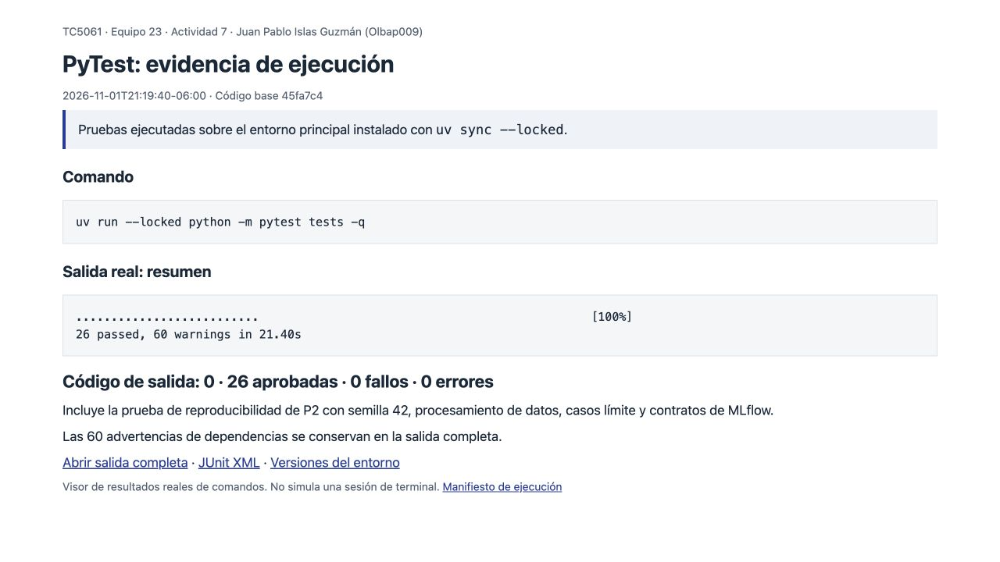
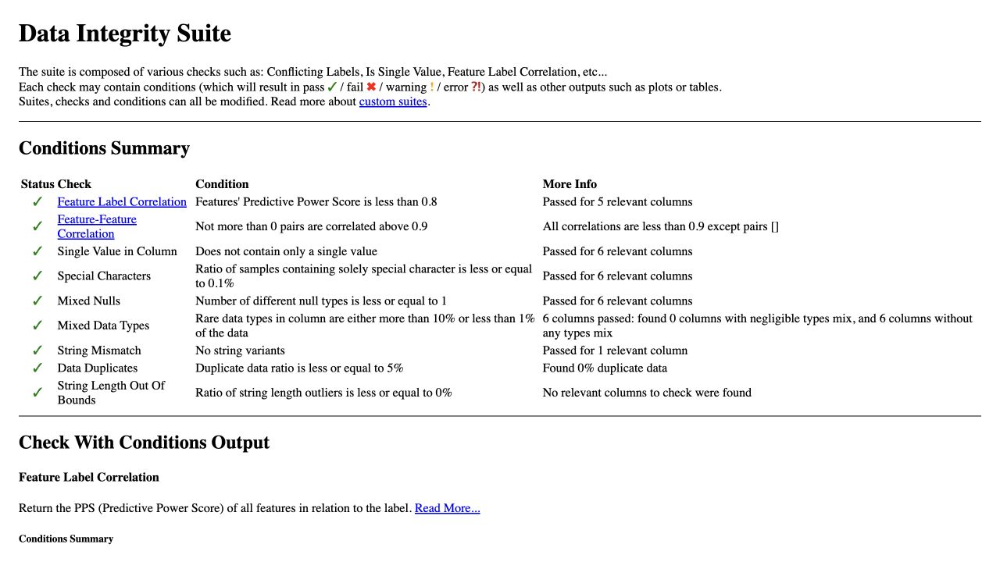
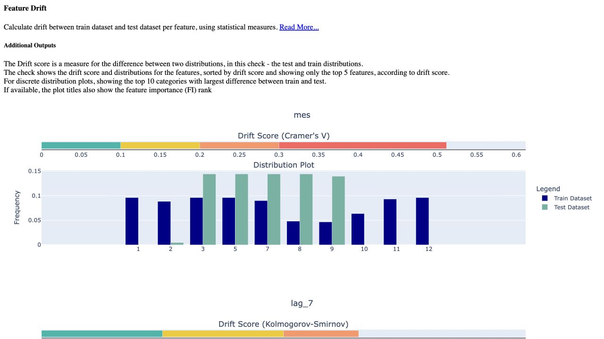
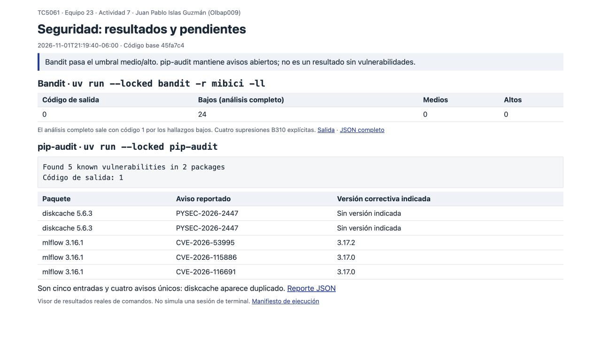

# Actividad 7: ejecución, evidencias y contribución

**Proyecto:** TC5061-Proyecto-Equipo23. **Contribución:** Juan Pablo Islas Guzmán,
A01797727 (`Olbap009`). **Fecha:** 1 de noviembre de 2026, America/Mexico_City.

Esta contribución documenta y verifica el trabajo integrado de pruebas,
DeepChecks y seguridad. La prueba de reproducibilidad fue aportada por Miguel Ángel,
la validación con DeepChecks por Kevin y los chequeos de seguridad por Bryan.
La documentación, ejecución de verificación y preparación de estas evidencias se
realizaron a solicitud de Juan Pablo con apoyo de Codex. Las capturas corresponden
a resultados de comandos ejecutados; no son resultados inventados ni evidencia de
un envío en Canvas.

## 1. Entorno principal y pruebas

Requisitos: Git, [uv](https://docs.astral.sh/uv/) y Python 3.13. Ejecutar desde la
raíz del repositorio:

```bash
uv sync --locked
uv run --locked python -m pytest tests -q
# Alternativa si está instalado Task:
task test
```

`uv sync --locked` instala el proyecto y su grupo de desarrollo sin actualizar el
archivo de versiones. Las pruebas están en `tests/`; comprueban procesamiento de
fechas y estaciones, construcción de variables, particiones temporales, artefactos
de MLflow y reproducibilidad. Incluyen fechas inválidas, IDs duplicados, intervalos
faltantes y estaciones inactivas. Usan datos pequeños construidos en las pruebas;
no requieren las credenciales del bucket ni el dataset completo.

Para ejecutar únicamente la reproducibilidad:

```bash
uv run --locked python -m pytest tests/test_p2_reproducibilidad.py -q
```

La prueba repite el muestreo del proyecto y el ajuste de un árbol con semilla 42,
y compara las predicciones. El resultado registrado fue **26 pruebas aprobadas**,
sin errores ni fallos. Las advertencias de dependencias se conservan en la salida
para que no se confundan con fallos o se oculten.

## 2. Datos reales para DeepChecks

El script requiere `data/processed/p1_demanda_diaria.csv`. Si ya se dispone de ese
archivo del proyecto, ubicarlo en esa ruta y registrar su hash. Si se reconstruye:

```bash
# Requiere acceso de lectura al bucket de DVC del equipo.
gcloud auth application-default login
uv run --locked dvc pull dataset

# Construye la serie diaria de P1 desde data/processed/trips.parquet.
uv run --locked python -m mibici.project_cli ingest --question P1 --build true
```

No sustituir los datos por una descarga distinta o por datos sintéticos sin
declararlo. El CSV derivado de P1 no está publicado en Git ni tiene una salida
propia en `dvc.yaml`; conservar su hash permite identificar qué archivo se validó.

**Datos utilizados en estas evidencias:** copia real de P1 conservada en el proyecto
local del curso, `Semana 5/MiBici_Proyecto/data/processed/p1_demanda_diaria.csv`.
Contiene **1,075 registros**, del **22 de octubre de 2023 al 30 de septiembre de
2026**. SHA-256:

```text
36ecd695ac7bd9b4e6256445a9c299f2c9d05d950808d5788f54bbb366656e70
```

La copia de viajes local de la que procede no coincide con el MD5 de la salida
`dataset` del `dvc.lock` revisado. Esta validación identifica expresamente el CSV
local; **no certifica que sea el dataset canónico remoto ni reproduce las corridas
de MLflow de otra entrega**. Para validar una reconstrucción desde DVC, volver a
ejecutar los chequeos y registrar el nuevo hash. El manifiesto de esta ejecución
está en [ejecucion.json](ejecucion.json). No se suben viajes individuales a Git.

## 3. Entorno separado de DeepChecks

`requirements-deepchecks.txt` fija DeepChecks 0.19.1, NumPy 1.26.4, pandas 2.2.2 y
scikit-learn 1.5.2. El proyecto principal usa Python 3.13 y versiones diferentes.
Para evitar reemplazar esas dependencias, preparar un segundo entorno con
Python 3.12. No ejecutar `uv sync` dentro de ese entorno ni instalar sobre él el
proyecto principal con sus dependencias.

Linux/macOS:

```bash
uv venv --python 3.12 .venv-deepchecks
uv pip install --python .venv-deepchecks/bin/python -r requirements-deepchecks.txt
.venv-deepchecks/bin/python -m mibici.validation.deepchecks_validation
# Con Task, después de preparar entorno y CSV:
task deepchecks
```

Windows PowerShell:

```powershell
uv venv --python 3.12 .venv-deepchecks
uv pip install --python .venv-deepchecks/Scripts/python.exe -r requirements-deepchecks.txt
.venv-deepchecks/Scripts/python.exe -m mibici.validation.deepchecks_validation
```

El script produce en `reports/evidence/deepchecks/`:

- `integrity_summary.json`: nulos, filas/fechas duplicadas, negativos y rangos.
- `deepchecks_integrity.html`: suite de integridad, tipos mixtos y otros controles.
- `deepchecks_drift.html`: comparación entre entrenamiento y prueba.
- `deepchecks_integrity.json` y `deepchecks_drift.json`: resultados estructurados
  de DeepChecks, sin los objetos gráficos.

Abrir los HTML en un navegador. Se exportan con `as_widget=False` para evitar
la incompatibilidad de widgets que dejaba la página en blanco. Son informes
autónomos con gráficas de varios megabytes;
se regeneran localmente y se excluyen de Git. Aquí se publican capturas de los
informes, el resumen estructurado y la salida de ejecución. El entorno principal
queda fijado por `uv.lock`; [deepchecks_versions.json](deepchecks_versions.json)
identifica las dependencias del segundo entorno realmente utilizado, cuyas
dependencias transitivas no tienen un lock propio en el repositorio.

### Interpretación de los resultados

En el CSV identificado, las reglas manuales no encontraron nulos, duplicados,
valores negativos ni valores fuera de los rangos definidos. DeepChecks reportó
duplicados 0.0 y ningún tipo mixto en las columnas analizadas. El corte temporal
fue **645 / 215 / 215** registros para entrenamiento, validación y prueba.

El drift entre entrenamiento y prueba fue:

| Variable | Estadístico | Valor |
| --- | --- | ---: |
| `dia_semana` | Cramer's V | 0.0000 |
| `mes` | Cramer's V | 0.5118 |
| `fin_semana` | Cramer's V | 0.0000 |
| `lag_1` | Kolmogorov-Smirnov | 0.2341 |
| `lag_7` | Kolmogorov-Smirnov | 0.2620 |

La diferencia en `mes` refleja distribuciones distintas entre periodos temporales;
los valores no prueban por sí solos una causa ni una pérdida de rendimiento del
modelo. La suite puede mostrar advertencias de correlación u otros controles;
no se declara que todos los chequeos estén aprobados solo porque terminó el
proceso. El script actual genera resultados, pero no tiene un umbral de drift
que haga terminar el proceso con error.

La suite de integridad reportó nueve condiciones aprobadas y un chequeo de
outliers sin condición de aprobación. Dos chequeos no se pudieron aplicar:
`Conflicting Labels` es irrelevante para regresión y `Identifier Label Correlation`
requiere un índice o fecha que el objeto `Dataset` actual no proporciona.
Los resultados JSON conservan ambos motivos. No se cuentan como pruebas aprobadas.

## 4. Seguridad y códigos de salida

```bash
# Solo severidad media/alta:
uv run --locked bandit -r mibici -ll
# Informe completo, incluyendo severidad baja:
uv run --locked bandit -r mibici
# Auditoría del entorno principal instalado:
uv run --locked pip-audit

# Alternativas con Task:
task security:bandit
task security:audit
task security:check
```

Resultados registrados:

| Análisis | Resultado | Interpretación |
| --- | --- | --- |
| Bandit con `-ll` | Código 0; 0 medios/altos | Pasa el umbral configurado. |
| Bandit completo | 24 bajos, 0 medios/altos | No equivale a cero hallazgos; hay cuatro supresiones explícitas B310. |
| pip-audit | Código 1; cinco entradas en dos paquetes | Existen avisos abiertos; no es un análisis limpio. |

Las cinco entradas de pip-audit contienen **cuatro identificadores únicos**:
tres avisos de MLflow 3.16.1 y uno de diskcache 5.6.3, que aparece duplicado en
el reporte. Las versiones correctivas que indica la herramienta para MLflow son
3.17.0 o 3.17.2 según el aviso. Para diskcache no se indica una corrección.
El equipo debe probar las actualizaciones y documentar cualquier excepción
pendiente; esta contribución no cambia la versión contractual de MLflow ni
afirma haber remediado esos avisos.

Consultar la [auditoría de seguridad](../../security/auditoria_seguridad.md) y
el [reporte publicado de dependencias](../../security/pip_audit_report.md).
`task security:report` usa `|| true` para guardar evidencia; su salida exitosa
no demuestra ausencia de hallazgos. `task security:check` sí falla si pip-audit
detecta los avisos. Revisar siempre los resultados y el código de salida.

La plantilla `.env.example` no contiene credenciales reales. Mantener `.env`,
claves privadas, cuentas de servicio, datos y modelos fuera de Git. Instalar los
controles preventivos con `uv run --locked pre-commit install`. Una búsqueda de
patrones sobre 246 blobs del historial descargado no encontró coincidencias de
claves privadas o tokens habituales; ese resultado acotado no garantiza que
ningún tipo de dato sensible pueda existir.

## Capturas y archivos de evidencia

Las capturas se obtuvieron de los informes de DeepChecks y de un visor local de
las salidas reales. El visor identifica los comandos y conserva enlaces a las
salidas completas; no simula una sesión de terminal.

| Evidencia | Archivo |
| --- | --- |
| Resultado de PyTest | [pytest.png](pytest.png), [salida](pytest_ejecucion.txt), [JUnit XML](pytest_resultado.xml) |
| Suite de integridad de DeepChecks | [deepchecks_integrity.png](deepchecks_integrity.png) |
| Drift entre entrenamiento y prueba | [deepchecks_drift.png](deepchecks_drift.png), [salida completa](deepchecks_ejecucion.txt) |
| Resultados estructurados de DeepChecks | [integridad](../deepchecks/deepchecks_integrity.json), [drift](../deepchecks/deepchecks_drift.json) |
| Bandit y pip-audit | [seguridad.png](seguridad.png), [Bandit](bandit_ejecucion.txt), [pip-audit](pip_audit_ejecucion.txt) |
| Resultado estructurado Bandit | [bandit_revision.json](bandit_revision.json) |
| Resultado estructurado pip-audit | [pip_audit_revision.json](pip_audit_revision.json) |
| Procedencia, versiones y códigos de salida | [ejecucion.json](ejecucion.json), [deepchecks_versions.json](deepchecks_versions.json) |









## Alcance de la contribución

Esta rama agrega documentación reproducible, una tarea para ejecutar DeepChecks
y evidencia verificable de ejecución. Corrige además la exportación HTML de
DeepChecks y conserva sus resultados estructurados. La autoría de código previo se conserva en
el historial. No modifica los modelos ni los resultados de entrenamiento, y no
declara aprobaciones de PR, participación equilibrada del equipo o entrega en
Canvas sin evidencia de esos hechos.
